# SkyTrack UI Agent Rules: Flow and Structure

This map shows how an agent should read and apply the SkyTrack UI rules for one implementation task. It also separates active policy from component evidence and the unmerged experiment.

## End-to-end execution flow

```mermaid
flowchart TD
    A([New task]) --> B[Read root AGENTS.md and scoped instructions]
    B --> C{Is this a UI task?}
    C -- No --> C1[Follow the task's topic instructions]
    C -- Yes --> D[Read active UI_RULES.md]
    D --> E[Read portable design-system-implementation.md]
    E --> I{Reference-based, marketing, graphic, or art-direction delivery?}
    I -- Yes --> J[Read design-system-delivery skill]
    I -- No --> K[Use implementation rules without selecting a creative mode]
    J --> L{Mode already specified?}
    L -- Yes --> M[Use supplied STRICT or YOLO mode]
    L -- No --> N[Ask Owner to select STRICT or YOLO]
    M --> O[Classify reference: faithful, inspiration, or unclear]
    N --> O
    O --> P[Identify user role, task, object, risk, and decision]
    K --> P
    P --> Q[Research IA from brief, shell/routes, nearby flow, and object/process data]
    Q --> R{Evidence sufficient and consistent?}
    R -- No --> S{Could uncertainty change grouping, order, or task path?}
    S -- Yes --> T[Research relevant external IA patterns; compare fit]
    S -- No --> U[Use the strongest project pattern; record a reversible assumption]
    T --> V{Owner-only or material decision still unresolved?}
    V -- Yes --> W[Ask Owner; pause only dependent implementation]
    V -- No --> X[Write concise evidence-backed IA outline]
    U --> X
    R -- Yes --> X
    X --> Y{Product UI or marketing?}
    Y -- Product --> Z[Use domain navigation and task-first content order; group fields by object and risk]
    Y -- Marketing --> AA[Build narrative around audience, message, and desired action]
    Z --> AB{Creative mode active?}
    AA --> AB
    AB -- STRICT --> AC[Show IA outline at the checkpoint before dependent coding]
    AB -- YOLO --> AD[Prepare outline before coding; proceed and disclose material assumptions]
    AB -- Not applicable --> AE[Use outline; skip mode checkpoint for routine UI work]
    AC --> AF{Could skytrack-ui meet a task need?}
    AD --> AF
    AE --> AF
    AF -- Yes --> AG[Scan all families once in the active component decision index]
    AF -- No --> AH[Use semantic structure and available project controls]
    AG --> AI[Shortlist plausible component families]
    AI --> AJ[Map every distinct UI need to candidate components and a reuse/custom decision]
    AJ --> AK[Read needed component guidance; verify installed exports, types, source, and compatible demos]
    AK --> AL{Supported component/composition fits?}
    AL -- Yes --> AM[Use library composition and preserve behavior/a11y]
    AL -- No --> AN[Name concrete gap; test whether existing parts compose it]
    AN --> AO{Can supported parts cover the need?}
    AO -- Yes --> AM
    AO -- No --> AP[Build only the missing local piece with semantic HTML, tokens, and supported controls]
    AM --> AQ[Implement IA, states, tokens, and interactions]
    AP --> AQ
    AH --> AQ
    AQ --> AR[Recheck coverage map, chart/progress meaning, semantic colors, text-base hierarchy, a11y, and layout]
    AR --> AS[Run task-appropriate checks; inspect browser when UI evidence is required]
    AS --> AT{Any failed criterion or material mismatch?}
    AT -- Yes --> AU[Fix within scope and repeat focused checks]
    AU --> AS
    AT -- No --> AV[Report changed paths, evidence, limits, and unresolved decisions]
    AV --> AW([Task complete])
```



### Decision rules to keep visible

- `AGENTS.md` routes the task and sets repository-wide boundaries. `UI_RULES.md` governs product and visual decisions. `AGENT_GUIDE.md` is a selective package reference. Installed package artifacts decide whether an API is usable.
- For product UI, organize navigation around the product domain and the screen around the user's task. Keep one object's information together, then order objects by task and dependency. Surface information needed for the current decision; disclose lower-priority detail.
- For marketing, organize the page around the audience, primary message, and desired action rather than forcing data-object groups.
- For references, honor explicit faithful-copy or inspiration intent. If unclear, resolve from task evidence; choose and state a reversible interpretation when impact is small. If interpretation could materially change structure or outcome, raise it at the STRICT checkpoint or choose and disclose the best-supported path in YOLO; ask when an Owner-only decision remains.
- STRICT presents the IA outline before dependent implementation. YOLO creates the outline before coding, proceeds autonomously, and surfaces material assumptions or trade-offs.
- Make one quick pass over the active `knowledge/COMPONENT_ROUTING.md`, then map every distinct UI need (group repeated instances) to candidate families and a reuse/custom decision. The map is mandatory before implementation; a router scan alone does not authorize custom UI. For each shortlisted candidate, inspect the target install's version/exports, relevant Developer guide, source/types, and closest compatible demo. Read its Designer guide when a UX/use decision is active. Do not open unrelated component evidence or every guide. `draft/COMPONENT_ROUTING.md` is historical experimental material and is not the active router. Do not infer support from names, source-only files, or another package version.
- Prefer a supported component or composition. Use local fallback only for a specific capability gap that verified parts cannot cover. Do not modify shared library APIs unless the task authorizes it.
- Use semantic status tokens, and token-linked chart category colors; do not use raw Tailwind palette colors for semantic states. Default ordinary interface/data text to `text-base`; smaller sizes require a clear subordinate hierarchy and must not be applied to a parent containing primary text. Use `.sub-heading` for its specified label/group roles and preserve its shared typography.
- Treat historical rates and category shares as charts, even when drawn as bars. Use Progress only for a task currently underway; use Meter for a current value against a known range.
- Verify only what the task needs, but never claim an uninspected viewport, state, or interaction passed. Follow the repository's build policy.

## Rule tree

```text
SkyTrack/
├── AGENTS.md
├── agents/
│   ├── workflow.md
│   ├── design-system-implementation.md
│   ├── validation-review.md
│   ├── continuity.md
│   ├── delegation.md
│   └── orchestration.md
├── .agents/skills/design-system-delivery/
│   ├── SKILL.md
│   └── references/
│       ├── skytrack-ui.md
│       └── creative-direction.md
└── designs/components/skytrack-ui/
    ├── UI_RULES.md
    ├── AGENT_GUIDE.md
    ├── knowledge/
    │   ├── README.md
    │   ├── COMPONENT_ROUTING.md
    │   ├── _template.md
    │   ├── <component>.md
    │   └── designer/<component>.md
    ├── src/
    │   ├── components/ui/
    │   └── demos/
    ├── package.json and dist-lib/
    └── draft/
        ├── README.md
        ├── AGENT_GUIDELINE.md
        ├── COMPONENT_ROUTING.md
        ├── CODE_EXAMPLES.md
        └── AUDIT_NOTES.md
```

## What each level does

| Level / path | Function | Authority |
| --- | --- | --- |
| `AGENTS.md` | Entry point. Tells the agent which instructions to read, their order, repository boundaries, and where SkyTrack UI policy lives. | Active, workspace-wide |
| `agents/` | Cross-project procedures. `workflow.md` routes work; `design-system-implementation.md` holds portable UI/IA rules; `validation-review.md` defines evidence; continuity/delegation/orchestration define task state and workers. | Active, workspace-wide |
| `.agents/skills/design-system-delivery/` | Optional workflow for full reference-based UI, marketing, graphics, and art direction. `SKILL.md` handles STRICT/YOLO; references add the SkyTrack adapter and creative direction. It does not override mandatory project rules. | Active, invoked by task type |
| `designs/components/skytrack-ui/UI_RULES.md` | SkyTrack-specific product/UI decisions, IA, responsive priorities, and chart rules. | Active, project policy |
| `designs/components/skytrack-ui/AGENT_GUIDE.md` | Detailed library reference. Open only the heading needed for package-wide setup, styling, or composition; never load the whole guide by default. | Active, selective reference |
| `knowledge/COMPONENT_ROUTING.md` | One-pass user-need-to-component-family index for scanning all available families and shortlisting likely candidates before custom work. | Active, canonical decision router |
| `knowledge/README.md` | Inventory of component families, audience editions, and documentation conventions. Use when inventory or page structure is needed. | Active, reference index |
| `knowledge/<component>.md` | Developer guide for one component: supported usage and implementation details. | Active, component guidance |
| `knowledge/designer/<component>.md` | Designer guide for the same component: when to use it and UX behavior/layout/content guidance. | Active, component guidance |
| `knowledge/_template.md` | Required structure used when authoring or maintaining component guidance. | Active, documentation convention |
| `src/components/ui/`, `src/demos/`, `package.json`, `dist-lib/` | Implementation and package evidence. Use source/types/demos to confirm APIs and installed-version support; these folders are evidence, not agent-policy documents. | Technical source of truth for API facts |
| `draft/` | Historical candidate bundle. Its `COMPONENT_ROUTING.md` is not the active component router; use `knowledge/COMPONENT_ROUTING.md` for current work. | Experimental; do not load for normal tasks |

The isolated `skytrack-ui-rule-probe/` folder is a test harness outside this rule tree. It can show how a draft performs in test tasks, but it is not an authority for product rules or package APIs.

## Read path for a normal component task

1. Read root `AGENTS.md` and applicable task instructions.
2. Read `designs/components/skytrack-ui/UI_RULES.md`, then `agents/design-system-implementation.md`.
3. If `skytrack-ui` may fit, scan `knowledge/COMPONENT_ROUTING.md`, then map each distinct UI need to candidate families and a reuse/custom decision.
4. Read the needed candidate guidance and verify its exact installed exports, types/source, and compatible demo before implementation. Open only relevant `AGENT_GUIDE.md` headings for package-wide questions.
5. Implement supported candidates first. Build only a documented capability gap as local UI.
6. Compare the rendered route against the coverage map; verify behavior, accessibility, visual result, token use, text hierarchy, and task scenarios.
7. Keep `draft/` out of normal task routing; consult it only when explicitly reviewing the experiment.
