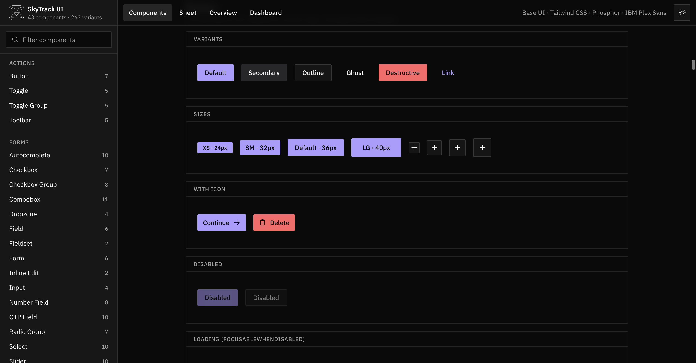
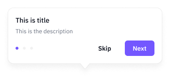
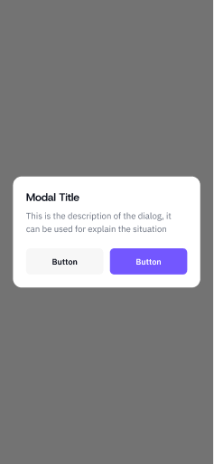

# Figma Design System vs `skytrack-ui`

**Status: IN_PROGRESS (full component-set inventory + partial visual preview)**  
**Ngày đọc:** 2026-10-28  
**Figma:** [Headless Design System — page Button | Link](https://www.figma.com/design/RFLUJoxC8ynCBY9t7vcVSQ/Headless-Design-System--Copy-?node-id=119-3655)  
**Mode được yêu cầu:** collection `- Brand`, mode `SkyTrack` (có trong file).

## Cách đọc

- Đọc canvas qua Figma Plugin API. Lấy số variant, kích thước, corner radius, padding, gap, cùng font family/size/weight/line-height của mẫu text đầu tiên trong component đầu tiên mỗi set.
- `SkyTrack` là mode thứ hai của collection `- Brand`. Live traversal mới nhất đã rà 101 component sets và 1,080 variant+size combinations; data variants được lưu ở hai snapshot liên kết. Bảng chính hiển thị một variant đại diện cho mỗi set. Mode thực tế có thể ảnh hưởng font tokens; phần comparison cũ được giữ để tham khảo và cần reconcile trước khi dùng làm kết luận cuối.
- Đây là snapshot representative variant, không phải bảng mọi variant. Đơn vị Figma là px. `—` nghĩa là không có giá trị tương ứng hoặc không thể so trực tiếp.
- Code specs đọc từ source `designs/components/skytrack-ui/src`; utility Tailwind quy đổi theo mặc định Tailwind. Variant, `className`, nội dung, theme và responsive state có thể đổi kết quả.

## All Figma component sets — representative sample per set

Figma live inventory: 101 component sets and 1,080 variant+size combinations. The matrix below shows one representative variant per set; all variant names/geometries are in the linked snapshots. Screenshot rows are included for every set; unavailable captures are marked.

| Component | Variant | Size | Property | Headless | `skytrack-ui` |
|---|---|---|---|---|---|
| `ds-avatar` | `Size=16, Square=False, Strong=True` | 16×16 | Screenshot | — capture pending | — capture pending |
|  |  |  | Size | 16×16 (set has 44 variants) | Mapped to `avatar`; per-variant value not in source inventory |
|  |  |  | Radius | 0px | Mapped to `avatar`; inspect source for value |
|  |  |  | Padding | 0/0/0/0px T/R/B/L | Mapped to `avatar`; inspect source for value |
|  |  |  | Gap | 0px | Mapped to `avatar`; inspect source for value |
|  |  |  | Typography | Not captured in this snapshot | Mapped to `avatar`; inspect source for value |
| `ds-thumb-image` | `Image=Custom` | 40×40 | Screenshot | — capture pending | — no direct equivalent |
|  |  |  | Size | 40×40 (set has 8 variants) | — no direct equivalent |
|  |  |  | Radius | 0px | — no direct equivalent |
|  |  |  | Padding | 0/0/0/0px T/R/B/L | — no direct equivalent |
|  |  |  | Gap | 0px | — no direct equivalent |
|  |  |  | Typography | Not captured in this snapshot | — no direct equivalent |
| `ds-avatar-location` | `Count=1` | 56×56 | Screenshot | — capture pending | — no direct equivalent |
|  |  |  | Size | 56×56 (set has 10 variants) | — no direct equivalent |
|  |  |  | Radius | 9999px | — no direct equivalent |
|  |  |  | Padding | 4/4/4/4px T/R/B/L | — no direct equivalent |
|  |  |  | Gap | 0px | — no direct equivalent |
|  |  |  | Typography | Not captured in this snapshot | — no direct equivalent |
| `ds-button` | `Button Icon=False, Type=Primary, Size=S, Disabled=False` | 73×32 | Screenshot |  |  |
|  |  |  | Size | 73×32 (set has 320 variants) | variants xs24 / sm32 / default36 / lg40 |
|  |  |  | Radius | 6px | 2px |
|  |  |  | Padding | 6/10/6/10px T/R/B/L | sm x12px; default x16/y8px |
|  |  |  | Gap | 0px | 6px |
|  |  |  | Typography | Not captured in this snapshot | IBM Plex Sans 14px/500, line 20px |
| `ds-badge` | `Type=Number, Style=Brand, Strong=False, Square=False` | 16×16 | Screenshot |  | — capture pending |
|  |  |  | Size | 16×16 (set has 70 variants) | small16 / default20px |
|  |  |  | Radius | 9999px | regular no radius; dot full radius |
|  |  |  | Padding | 0/4/0/4px T/R/B/L | small x4 / default x6px |
|  |  |  | Gap | 0px | — |
|  |  |  | Typography | Not captured in this snapshot | IBM Plex Sans 11px/500 small, 12px/500 default |
| `ds-badge-status` | `Type=Online` | 8×8 | Screenshot | — capture pending | — no direct equivalent |
|  |  |  | Size | 8×8 (set has 7 variants) | — no direct equivalent |
|  |  |  | Radius | 8px | — no direct equivalent |
|  |  |  | Padding | 0/0/0/0px T/R/B/L | — no direct equivalent |
|  |  |  | Gap | 0px | — no direct equivalent |
|  |  |  | Typography | Not captured in this snapshot | — no direct equivalent |
| `ds-card` | `Style=Alpha, Selected=False` | 392×192 | Screenshot |  | — no direct equivalent |
|  |  |  | Size | 392×192 (set has 6 variants) | — no direct equivalent |
|  |  |  | Radius | 12px | — no direct equivalent |
|  |  |  | Padding | 16/16/16/16px T/R/B/L | — no direct equivalent |
|  |  |  | Gap | 0px | — no direct equivalent |
|  |  |  | Typography | Not captured in this snapshot | — no direct equivalent |
| `ds-callout` | `Style=Neutral, Button Vertical=False, Title=False` | 350×40 | Screenshot |  | — capture pending |
|  |  |  | Size | 350×40 (set has 16 variants) | Mapped to `alert`; per-variant value not in source inventory |
|  |  |  | Radius | 8px | Mapped to `alert`; inspect source for value |
|  |  |  | Padding | 8/12/8/12px T/R/B/L | Mapped to `alert`; inspect source for value |
|  |  |  | Gap | 12px | Mapped to `alert`; inspect source for value |
|  |  |  | Typography | Not captured in this snapshot | Mapped to `alert`; inspect source for value |
| `ds-chip` | `Icon Chip=False, Size=S, State=Enabled, Square=True` | 48×32 | Screenshot |  | — no direct equivalent |
|  |  |  | Size | 48×32 (set has 96 variants) | — no direct equivalent |
|  |  |  | Radius | 6px | — no direct equivalent |
|  |  |  | Padding | 6/8/6/8px T/R/B/L | — no direct equivalent |
|  |  |  | Gap | 4px | — no direct equivalent |
|  |  |  | Typography | Not captured in this snapshot | — no direct equivalent |
| `ds-checkbox` | `Selected=False, Size=M, Indeterminate=False, Disabled=False` | 24×24 | Screenshot |  | — capture pending |
|  |  |  | Size | 24×24 (set has 12 variants) | 16×16px |
|  |  |  | Radius | 6px | 2px |
|  |  |  | Padding | 0/0/0/0px T/R/B/L | — |
|  |  |  | Gap | 0px | — |
|  |  |  | Typography | Not captured in this snapshot | — |
| `ds-radio` | `Selected=False, Size=M, Disabled=False` | 24×24 | Screenshot | — capture pending | — capture pending |
|  |  |  | Size | 24×24 (set has 8 variants) | Mapped to `radio`; per-variant value not in source inventory |
|  |  |  | Radius | 9999px | Mapped to `radio`; inspect source for value |
|  |  |  | Padding | 0/0/0/0px T/R/B/L | Mapped to `radio`; inspect source for value |
|  |  |  | Gap | 0px | Mapped to `radio`; inspect source for value |
|  |  |  | Typography | Not captured in this snapshot | Mapped to `radio`; inspect source for value |
| `ds-switch` | `On=False, Size=M, Disabled=False` | 40×24 | Screenshot | — capture pending | — capture pending |
|  |  |  | Size | 40×24 (set has 12 variants) | Mapped to `switch`; per-variant value not in source inventory |
|  |  |  | Radius | 9999px | Mapped to `switch`; inspect source for value |
|  |  |  | Padding | 3/3/3/3px T/R/B/L | Mapped to `switch`; inspect source for value |
|  |  |  | Gap | 0px | Mapped to `switch`; inspect source for value |
|  |  |  | Typography | Not captured in this snapshot | Mapped to `switch`; inspect source for value |
| `ds-tab-title-item` | `State=Active` | 31×26 | Screenshot | — capture pending | — capture pending |
|  |  |  | Size | 31×26 (set has 2 variants) | Mapped to `tabs`; per-variant value not in source inventory |
|  |  |  | Radius | 0px | Mapped to `tabs`; inspect source for value |
|  |  |  | Padding | 0/0/0/0px T/R/B/L | Mapped to `tabs`; inspect source for value |
|  |  |  | Gap | 0px | Mapped to `tabs`; inspect source for value |
|  |  |  | Typography | IBM Plex Sans SemiBold 18/26 | Mapped to `tabs`; inspect source for value |
| `ds-tab-item` | `Active=True` | 26×32 | Screenshot | — capture pending | — capture pending |
|  |  |  | Size | 26×32 (set has 2 variants) | Mapped to `tabs`; per-variant value not in source inventory |
|  |  |  | Radius | 0px | Mapped to `tabs`; inspect source for value |
|  |  |  | Padding | 0/0/10/0px T/R/B/L | Mapped to `tabs`; inspect source for value |
|  |  |  | Gap | 6px | Mapped to `tabs`; inspect source for value |
|  |  |  | Typography | IBM Plex Sans SemiBold 15/22 | Mapped to `tabs`; inspect source for value |
| `ds-pill-item` | `Active=True` | 64×30 | Screenshot | — capture pending | — capture pending |
|  |  |  | Size | 64×30 (set has 2 variants) | Mapped to `toggle-group`; per-variant value not in source inventory |
|  |  |  | Radius | 8px | Mapped to `toggle-group`; inspect source for value |
|  |  |  | Padding | 4/12/4/12px T/R/B/L | Mapped to `toggle-group`; inspect source for value |
|  |  |  | Gap | 6px | Mapped to `toggle-group`; inspect source for value |
|  |  |  | Typography | IBM Plex Sans SemiBold 15/22 | Mapped to `toggle-group`; inspect source for value |
| `ds-tabs` | `Type=Tabs, Width=Hug` | 350×40 | Screenshot | — capture pending | — capture pending |
|  |  |  | Size | 350×40 (set has 6 variants) | Mapped to `tabs`; per-variant value not in source inventory |
|  |  |  | Radius | 0px | Mapped to `tabs`; inspect source for value |
|  |  |  | Padding | 0/20/0/20px T/R/B/L | Mapped to `tabs`; inspect source for value |
|  |  |  | Gap | 16px | Mapped to `tabs`; inspect source for value |
|  |  |  | Typography | IBM Plex Sans SemiBold 15/22 | Mapped to `tabs`; inspect source for value |
| `ds-input-inline` | `Size=L, State=Enabled, Filled=False` | 350×48 | Screenshot |  | — capture pending |
|  |  |  | Size | 350×48 (set has 24 variants) | 36px control |
|  |  |  | Radius | 0px | 2px |
|  |  |  | Padding | 0/0/0/0px T/R/B/L | 12px 4px |
|  |  |  | Gap | 0px | — |
|  |  |  | Typography | IBM Plex Sans Medium 13/18 | IBM Plex Sans 14px/400, line 20px |
| `ds-input-textarea` | `Size=L, State=Enabled, Filled=Off` | 350×94 | Screenshot | — capture pending | — capture pending |
|  |  |  | Size | 350×94 (set has 18 variants) | 36px control |
|  |  |  | Radius | 0px | 2px |
|  |  |  | Padding | 0/0/0/0px T/R/B/L | 12px 4px |
|  |  |  | Gap | 0px | — |
|  |  |  | Typography | IBM Plex Sans Medium 13/18 | IBM Plex Sans 14px/400, line 20px |
| `ds-search-bar` | `Size=M, Active=Off, Filled=Off` | 310×40 | Screenshot | — capture pending | — capture pending |
|  |  |  | Size | 310×40 (set has 12 variants) | 36px control |
|  |  |  | Radius | 0px | 2px |
|  |  |  | Padding | 0/0/0/0px T/R/B/L | 12px 4px |
|  |  |  | Gap | 12px | — |
|  |  |  | Typography | IBM Plex Sans Regular 14/20 | IBM Plex Sans 14px/400, line 20px |
| `ds-input-verify` | `State=Empty` | 352×82 | Screenshot | — capture pending | — capture pending |
|  |  |  | Size | 352×82 (set has 9 variants) | Mapped to `otp-field`; per-variant value not in source inventory |
|  |  |  | Radius | 0px | Mapped to `otp-field`; inspect source for value |
|  |  |  | Padding | 0/0/0/0px T/R/B/L | Mapped to `otp-field`; inspect source for value |
|  |  |  | Gap | 12px | Mapped to `otp-field`; inspect source for value |
|  |  |  | Typography | IBM Plex Sans Regular 12/16 | Mapped to `otp-field`; inspect source for value |
| `ds-list-item` | `Type=Default, Padding=False, Disabled=False` | 352×44 | Screenshot | — capture pending | — no direct equivalent |
|  |  |  | Size | 352×44 (set has 24 variants) | — no direct equivalent |
|  |  |  | Radius | 0px | — no direct equivalent |
|  |  |  | Padding | 0/0/0/0px T/R/B/L | — no direct equivalent |
|  |  |  | Gap | 16px | — no direct equivalent |
|  |  |  | Typography | IBM Plex Sans Regular 16/24 | — no direct equivalent |
| `ds-grid-item` | `Disabled=False` | 126×120 | Screenshot | — capture pending | — no direct equivalent |
|  |  |  | Size | 126×120 (set has 2 variants) | — no direct equivalent |
|  |  |  | Radius | 0px | — no direct equivalent |
|  |  |  | Padding | 12/12/12/12px T/R/B/L | — no direct equivalent |
|  |  |  | Gap | 16px | — no direct equivalent |
|  |  |  | Typography | IBM Plex Sans Regular 12/16 | — no direct equivalent |
| `ds-tree-view` | `Selected=False, Level=Parent, Expanded=False` | 220×32 | Screenshot | — capture pending | — no direct equivalent |
|  |  |  | Size | 220×32 (set has 6 variants) | — no direct equivalent |
|  |  |  | Radius | 8px | — no direct equivalent |
|  |  |  | Padding | 8/8/8/8px T/R/B/L | — no direct equivalent |
|  |  |  | Gap | 8px | — no direct equivalent |
|  |  |  | Typography | IBM Plex Sans Regular 14/20 | — no direct equivalent |
| `ds-banner` | `Type=Offline` | 390×32 | Screenshot | — capture pending | — capture pending |
|  |  |  | Size | 390×32 (set has 3 variants) | Mapped to `alert`; per-variant value not in source inventory |
|  |  |  | Radius | 0px | Mapped to `alert`; inspect source for value |
|  |  |  | Padding | 0/20/0/20px T/R/B/L | Mapped to `alert`; inspect source for value |
|  |  |  | Gap | 8px | Mapped to `alert`; inspect source for value |
|  |  |  | Typography | IBM Plex Sans Regular 12/16 | Mapped to `alert`; inspect source for value |
| `ds-sheet` | `Type=Modal, Height=Hug Content` | 393×852 | Screenshot | — capture pending | — capture pending |
|  |  |  | Size | 393×852 (set has 6 variants) | Mapped to `drawer`; per-variant value not in source inventory |
|  |  |  | Radius | 0px | Mapped to `drawer`; inspect source for value |
|  |  |  | Padding | 0/0/0/0px T/R/B/L | Mapped to `drawer`; inspect source for value |
|  |  |  | Gap | 0px | Mapped to `drawer`; inspect source for value |
|  |  |  | Typography | Host Grotesk SemiBold 20/28 | Mapped to `drawer`; inspect source for value |
| `.animation-sheet-active` | `Step=1` | 393×852 | Screenshot | — capture pending | — no direct equivalent |
|  |  |  | Size | 393×852 (set has 2 variants) | — no direct equivalent |
|  |  |  | Radius | 0px | — no direct equivalent |
|  |  |  | Padding | 0/0/0/0px T/R/B/L | — no direct equivalent |
|  |  |  | Gap | 0px | — no direct equivalent |
|  |  |  | Typography | IBM Plex Sans SemiBold 15/22 | — no direct equivalent |
| `.animation-sheet-slide` | `Step=1` | 393×852 | Screenshot | — capture pending | — no direct equivalent |
|  |  |  | Size | 393×852 (set has 2 variants) | — no direct equivalent |
|  |  |  | Radius | 0px | — no direct equivalent |
|  |  |  | Padding | 0/0/0/0px T/R/B/L | — no direct equivalent |
|  |  |  | Gap | 0px | — no direct equivalent |
|  |  |  | Typography | Host Grotesk SemiBold 20/28 | — no direct equivalent |
| `.animation-sheet-popover` | `Step=1` | 393×852 | Screenshot | — capture pending | — no direct equivalent |
|  |  |  | Size | 393×852 (set has 2 variants) | — no direct equivalent |
|  |  |  | Radius | 0px | — no direct equivalent |
|  |  |  | Padding | 0/0/0/0px T/R/B/L | — no direct equivalent |
|  |  |  | Gap | 0px | — no direct equivalent |
|  |  |  | Typography | Host Grotesk SemiBold 20/28 | — no direct equivalent |
| `.animation-sheet-modal` | `Step=1` | 393×852 | Screenshot | — capture pending | — no direct equivalent |
|  |  |  | Size | 393×852 (set has 2 variants) | — no direct equivalent |
|  |  |  | Radius | 0px | — no direct equivalent |
|  |  |  | Padding | 0/0/0/0px T/R/B/L | — no direct equivalent |
|  |  |  | Gap | 0px | — no direct equivalent |
|  |  |  | Typography | IBM Plex Sans Regular 16/24 | — no direct equivalent |
| `ds-snackbar` | `Type=Default, Button Vertical=False` | 390×72 | Screenshot |  | — capture pending |
|  |  |  | Size | 390×72 (set has 12 variants) | Mapped to `toast`; per-variant value not in source inventory |
|  |  |  | Radius | 8px | Mapped to `toast`; inspect source for value |
|  |  |  | Padding | 12/20/12/20px T/R/B/L | Mapped to `toast`; inspect source for value |
|  |  |  | Gap | 4px | Mapped to `toast`; inspect source for value |
|  |  |  | Typography | IBM Plex Sans Regular 14/20 | Mapped to `toast`; inspect source for value |
| `ds-tooltip` | `Type=Complex` | 350×148 | Screenshot |  | — capture pending |
|  |  |  | Size | 350×148 (set has 2 variants) | Mapped to `tooltip`; per-variant value not in source inventory |
|  |  |  | Radius | 0px | Mapped to `tooltip`; inspect source for value |
|  |  |  | Padding | 16/16/16/16px T/R/B/L | Mapped to `tooltip`; inspect source for value |
|  |  |  | Gap | 0px | Mapped to `tooltip`; inspect source for value |
|  |  |  | Typography | IBM Plex Sans Medium 14/20 | Mapped to `tooltip`; inspect source for value |
| `ds-modal` | `Type=Dialog` | 393×852 | Screenshot |  | — capture pending |
|  |  |  | Size | 393×852 (set has 4 variants) | responsive popup, max-width lg |
|  |  |  | Radius | 0px | 2px |
|  |  |  | Padding | 24/24/24/24px T/R/B/L | 24px |
|  |  |  | Gap | 0px | 16px |
|  |  |  | Typography | Host Grotesk SemiBold 20/28 | IBM Plex Sans global; popup inherits size |
| `ds-d-modal` | `Height=Hug Content, Title=Left` | 1440×1024 | Screenshot | — capture pending | — capture pending |
|  |  |  | Size | 1440×1024 (set has 6 variants) | responsive popup, max-width lg |
|  |  |  | Radius | 0px | 2px |
|  |  |  | Padding | 80/80/80/80px T/R/B/L | 24px |
|  |  |  | Gap | 0px | 16px |
|  |  |  | Typography | IBM Plex Sans SemiBold 18/26 | IBM Plex Sans global; popup inherits size |
| `ds-popover` | `Height=Hug Content` | 240×208 | Screenshot | — capture pending | — capture pending |
|  |  |  | Size | 240×208 (set has 2 variants) | Mapped to `popover`; per-variant value not in source inventory |
|  |  |  | Radius | 0px | Mapped to `popover`; inspect source for value |
|  |  |  | Padding | 8/8/8/8px T/R/B/L | Mapped to `popover`; inspect source for value |
|  |  |  | Gap | 0px | Mapped to `popover`; inspect source for value |
|  |  |  | Typography | — | Mapped to `popover`; inspect source for value |
| `ds-popover-dropdown` | `Height=Hug Content, Type=Default` | 240×160 | Screenshot | — capture pending | — capture pending |
|  |  |  | Size | 240×160 (set has 9 variants) | Mapped to `popover`; per-variant value not in source inventory |
|  |  |  | Radius | 12px | Mapped to `popover`; inspect source for value |
|  |  |  | Padding | 0/0/0/0px T/R/B/L | Mapped to `popover`; inspect source for value |
|  |  |  | Gap | 0px | Mapped to `popover`; inspect source for value |
|  |  |  | Typography | — | Mapped to `popover`; inspect source for value |
| `ds-popover-placement` | `Open DIrection=Bottom` | 80×40.000099182128906 | Screenshot | — capture pending | — capture pending |
|  |  |  | Size | 80×40.000099182128906 (set has 4 variants) | Mapped to `popover`; per-variant value not in source inventory |
|  |  |  | Radius | 0px | Mapped to `popover`; inspect source for value |
|  |  |  | Padding | 0/0/0/0px T/R/B/L | Mapped to `popover`; inspect source for value |
|  |  |  | Gap | 0px | Mapped to `popover`; inspect source for value |
|  |  |  | Typography | — | Mapped to `popover`; inspect source for value |
| `ds-breadcrumb-item` | `State=Enabled` | 36×20 | Screenshot | — capture pending | — capture pending |
|  |  |  | Size | 36×20 (set has 3 variants) | Mapped to `breadcrumb`; per-variant value not in source inventory |
|  |  |  | Radius | 0px | Mapped to `breadcrumb`; inspect source for value |
|  |  |  | Padding | 0/0/0/0px T/R/B/L | Mapped to `breadcrumb`; inspect source for value |
|  |  |  | Gap | 2px | Mapped to `breadcrumb`; inspect source for value |
|  |  |  | Typography | IBM Plex Sans Regular 14/20 | Mapped to `breadcrumb`; inspect source for value |
| `ds-breadcrumb` | `Type=Default` | 220×22 | Screenshot | — capture pending | — capture pending |
|  |  |  | Size | 220×22 (set has 1 variants) | Mapped to `breadcrumb`; per-variant value not in source inventory |
|  |  |  | Radius | 0px | Mapped to `breadcrumb`; inspect source for value |
|  |  |  | Padding | 1/0/1/0px T/R/B/L | Mapped to `breadcrumb`; inspect source for value |
|  |  |  | Gap | 4px | Mapped to `breadcrumb`; inspect source for value |
|  |  |  | Typography | IBM Plex Sans Regular 14/20 | Mapped to `breadcrumb`; inspect source for value |
| `.Charts / Bar Chart / Rectangle` | `Type=Default, Horizontal=False, Active=False` | 40×132 | Screenshot | — capture pending | — no direct equivalent |
|  |  |  | Size | 40×132 (set has 10 variants) | — no direct equivalent |
|  |  |  | Radius | 0px | — no direct equivalent |
|  |  |  | Padding | 0/0/0/0px T/R/B/L | — no direct equivalent |
|  |  |  | Gap | 8px | — no direct equivalent |
|  |  |  | Typography | SF Pro Display Regular 12/100 | — no direct equivalent |
| `.Charts / Bar Chart / Layer` | `Rectangles=1, Horizontal=False` | 48×105 | Screenshot | — capture pending | — no direct equivalent |
|  |  |  | Size | 48×105 (set has 6 variants) | — no direct equivalent |
|  |  |  | Radius | 0px | — no direct equivalent |
|  |  |  | Padding | 0/0/0/0px T/R/B/L | — no direct equivalent |
|  |  |  | Gap | 13px | — no direct equivalent |
|  |  |  | Typography | SF Pro Display Regular 12/100 | — no direct equivalent |
| `.Charts / Grid` | `Horizontal=False` | 401×254 | Screenshot | — capture pending | — no direct equivalent |
|  |  |  | Size | 401×254 (set has 2 variants) | — no direct equivalent |
|  |  |  | Radius | 0px | — no direct equivalent |
|  |  |  | Padding | 0/0/0/0px T/R/B/L | — no direct equivalent |
|  |  |  | Gap | 98px | — no direct equivalent |
|  |  |  | Typography | SF Pro Display Regular 12/100 | — no direct equivalent |
| `.Charts / Legend Item` | `Type=Default` | 44×16 | Screenshot | — capture pending | — no direct equivalent |
|  |  |  | Size | 44×16 (set has 2 variants) | — no direct equivalent |
|  |  |  | Radius | 0px | — no direct equivalent |
|  |  |  | Padding | 0/0/0/0px T/R/B/L | — no direct equivalent |
|  |  |  | Gap | 6px | — no direct equivalent |
|  |  |  | Typography | SF Pro Display Regular 12/16 | — no direct equivalent |
| `.Charts / Tooltip / Tooltip Item` | `Type=Default` | 108×12 | Screenshot | — capture pending | — no direct equivalent |
|  |  |  | Size | 108×12 (set has 4 variants) | — no direct equivalent |
|  |  |  | Radius | 0px | — no direct equivalent |
|  |  |  | Padding | 0/0/0/0px T/R/B/L | — no direct equivalent |
|  |  |  | Gap | 8px | — no direct equivalent |
|  |  |  | Typography | SF Pro Display Regular 12/100 | — no direct equivalent |
| `.Charts / Dot` | `Custom=False, Size=8` | 8×8 | Screenshot | — capture pending | — no direct equivalent |
|  |  |  | Size | 8×8 (set has 3 variants) | — no direct equivalent |
|  |  |  | Radius | 0px | — no direct equivalent |
|  |  |  | Padding | 0/0/0/0px T/R/B/L | — no direct equivalent |
|  |  |  | Gap | 1px | — no direct equivalent |
|  |  |  | Typography | SF Pro Display Regular 12/100 | — no direct equivalent |
| `.Charts / Dot on Stroke` | `Size=6` | 6×6 | Screenshot | — capture pending | — no direct equivalent |
|  |  |  | Size | 6×6 (set has 3 variants) | — no direct equivalent |
|  |  |  | Radius | 0px | — no direct equivalent |
|  |  |  | Padding | 0/0/0/0px T/R/B/L | — no direct equivalent |
|  |  |  | Gap | 1px | — no direct equivalent |
|  |  |  | Typography | SF Pro Display Regular 12/100 | — no direct equivalent |
| `.Charts / Pie Chart / Pie` | `Stroke=Yes` | 192×192 | Screenshot | — capture pending | — no direct equivalent |
|  |  |  | Size | 192×192 (set has 2 variants) | — no direct equivalent |
|  |  |  | Radius | 0px | — no direct equivalent |
|  |  |  | Padding | 0/0/0/0px T/R/B/L | — no direct equivalent |
|  |  |  | Gap | 0px | — no direct equivalent |
|  |  |  | Typography | — | — no direct equivalent |
| `.Charts / Radar Chart / Grid` | `Type=Default, Filled=No` | 192×192 | Screenshot | — capture pending | — no direct equivalent |
|  |  |  | Size | 192×192 (set has 4 variants) | — no direct equivalent |
|  |  |  | Radius | 0px | — no direct equivalent |
|  |  |  | Padding | 0/0/0/0px T/R/B/L | — no direct equivalent |
|  |  |  | Gap | 0px | — no direct equivalent |
|  |  |  | Typography | — | — no direct equivalent |
| `.Charts / Radar Chart / Label Wrapper` | `Type=Default` | 268.705078125×238 | Screenshot | — capture pending | — no direct equivalent |
|  |  |  | Size | 268.705078125×238 (set has 2 variants) | — no direct equivalent |
|  |  |  | Radius | 0px | — no direct equivalent |
|  |  |  | Padding | 0/0/0/0px T/R/B/L | — no direct equivalent |
|  |  |  | Gap | 0px | — no direct equivalent |
|  |  |  | Typography | SF Pro Display Regular 12/100 | — no direct equivalent |
| `.Chart / Bar Chart` | `Type=Basic` | 464×320 | Screenshot | — capture pending | — no direct equivalent |
|  |  |  | Size | 464×320 (set has 9 variants) | — no direct equivalent |
|  |  |  | Radius | 0px | — no direct equivalent |
|  |  |  | Padding | 0/0/0/0px T/R/B/L | — no direct equivalent |
|  |  |  | Gap | 36px | — no direct equivalent |
|  |  |  | Typography | SF Pro Display Regular 12/100 | — no direct equivalent |
| `.Chart / Area Chart` | `Type=Basic, Gradient=No` | 293×246 | Screenshot | — capture pending | — no direct equivalent |
|  |  |  | Size | 293×246 (set has 10 variants) | — no direct equivalent |
|  |  |  | Radius | 0px | — no direct equivalent |
|  |  |  | Padding | 0/0/0/0px T/R/B/L | — no direct equivalent |
|  |  |  | Gap | 36px | — no direct equivalent |
|  |  |  | Typography | SF Pro Display Regular 12/100 | — no direct equivalent |
| `.Chart / Line Chart` | `Type=Basic` | 293×246 | Screenshot | — capture pending | — no direct equivalent |
|  |  |  | Size | 293×246 (set has 7 variants) | — no direct equivalent |
|  |  |  | Radius | 0px | — no direct equivalent |
|  |  |  | Padding | 0/0/0/0px T/R/B/L | — no direct equivalent |
|  |  |  | Gap | 36px | — no direct equivalent |
|  |  |  | Typography | SF Pro Display Regular 12/100 | — no direct equivalent |
| `.Chart / Pie Chart / Full` | `Type=Basic` | 213×213 | Screenshot | — capture pending | — no direct equivalent |
|  |  |  | Size | 213×213 (set has 2 variants) | — no direct equivalent |
|  |  |  | Radius | 0px | — no direct equivalent |
|  |  |  | Padding | 0/0/0/0px T/R/B/L | — no direct equivalent |
|  |  |  | Gap | 36px | — no direct equivalent |
|  |  |  | Typography | SF Pro Display Regular 12/16 | — no direct equivalent |
| `.Chart / Pie Chart / Donut` | `Type=Basic` | 192×192 | Screenshot | — capture pending | — no direct equivalent |
|  |  |  | Size | 192×192 (set has 3 variants) | — no direct equivalent |
|  |  |  | Radius | 0px | — no direct equivalent |
|  |  |  | Padding | 0/0/0/0px T/R/B/L | — no direct equivalent |
|  |  |  | Gap | 36px | — no direct equivalent |
|  |  |  | Typography | SF Pro Display Bold 30/36 | — no direct equivalent |
| `.Chart / Radar Chart` | `Type=Basic` | 268.705078125×238 | Screenshot | — capture pending | — no direct equivalent |
|  |  |  | Size | 268.705078125×238 (set has 9 variants) | — no direct equivalent |
|  |  |  | Radius | 0px | — no direct equivalent |
|  |  |  | Padding | 23/38/23/38px T/R/B/L | — no direct equivalent |
|  |  |  | Gap | 10px | — no direct equivalent |
|  |  |  | Typography | SF Pro Display Regular 12/16 | — no direct equivalent |
| `.Chart / Radial Chart ` | `Type=Basic` | 199.2000732421875×199.2000732421875 | Screenshot | — capture pending | — no direct equivalent |
|  |  |  | Size | 199.2000732421875×199.2000732421875 (set has 6 variants) | — no direct equivalent |
|  |  |  | Radius | 0px | — no direct equivalent |
|  |  |  | Padding | 0/0/0/0px T/R/B/L | — no direct equivalent |
|  |  |  | Gap | 0px | — no direct equivalent |
|  |  |  | Typography | — | — no direct equivalent |
| `.Trading View Chart` | `Size=Browser • Desktop` | 640×534 | Screenshot | — capture pending | — no direct equivalent |
|  |  |  | Size | 640×534 (set has 3 variants) | — no direct equivalent |
|  |  |  | Radius | 0px | — no direct equivalent |
|  |  |  | Padding | 0/0/0/0px T/R/B/L | — no direct equivalent |
|  |  |  | Gap | 0px | — no direct equivalent |
|  |  |  | Typography | MiSans Latin VF Demibold 13/125 | — no direct equivalent |
| `ds-chart` | `Type=Default` | 390×295 | Screenshot | — capture pending | — no direct equivalent |
|  |  |  | Size | 390×295 (set has 2 variants) | — no direct equivalent |
|  |  |  | Radius | 0px | — no direct equivalent |
|  |  |  | Padding | 0/0/0/0px T/R/B/L | — no direct equivalent |
|  |  |  | Gap | 16px | — no direct equivalent |
|  |  |  | Typography | IBM Plex Sans Regular 12/16 | — no direct equivalent |
| `ds-chart-drawing` | `Type=Bar` | 350×280 | Screenshot | — capture pending | — no direct equivalent |
|  |  |  | Size | 350×280 (set has 4 variants) | — no direct equivalent |
|  |  |  | Radius | 0px | — no direct equivalent |
|  |  |  | Padding | 0/0/0/0px T/R/B/L | — no direct equivalent |
|  |  |  | Gap | 4px | — no direct equivalent |
|  |  |  | Typography | — | — no direct equivalent |
| `.Charts / Legend` | `.Charts / Legend` | 292×16 | Screenshot | — capture pending | — no direct equivalent |
|  |  |  | Size | 292×16 (set has 1 variants) | — no direct equivalent |
|  |  |  | Radius | 0px | — no direct equivalent |
|  |  |  | Padding | 0/0/0/0px T/R/B/L | — no direct equivalent |
|  |  |  | Gap | 16px | — no direct equivalent |
|  |  |  | Typography | SF Pro Display Regular 12/16 | — no direct equivalent |
| `.Charts / Pie Chart / Label Wrapper` | `.Charts / Pie Chart / Label Wrapper` | 244.7300567626953×213.33389282226562 | Screenshot | — capture pending | — no direct equivalent |
|  |  |  | Size | 244.7300567626953×213.33389282226562 (set has 1 variants) | — no direct equivalent |
|  |  |  | Radius | 0px | — no direct equivalent |
|  |  |  | Padding | 0/0/0/0px T/R/B/L | — no direct equivalent |
|  |  |  | Gap | 0px | — no direct equivalent |
|  |  |  | Typography | SF Pro Display Regular 12/100 | — no direct equivalent |
| `.Charts / Pie Chart / Label List` | `.Charts / Pie Chart / Label List` | 118.54347229003906×99.31057739257812 | Screenshot | — capture pending | — no direct equivalent |
|  |  |  | Size | 118.54347229003906×99.31057739257812 (set has 1 variants) | — no direct equivalent |
|  |  |  | Radius | 0px | — no direct equivalent |
|  |  |  | Padding | 0/0/0/0px T/R/B/L | — no direct equivalent |
|  |  |  | Gap | 0px | — no direct equivalent |
|  |  |  | Typography | SF Pro Display Regular 12/16 | — no direct equivalent |
| `.Charts / Tooltip` | `.Charts / Tooltip` | 139×114 | Screenshot | — capture pending | — no direct equivalent |
|  |  |  | Size | 139×114 (set has 1 variants) | — no direct equivalent |
|  |  |  | Radius | 8px | — no direct equivalent |
|  |  |  | Padding | 6/10/6/10px T/R/B/L | — no direct equivalent |
|  |  |  | Gap | 8px | — no direct equivalent |
|  |  |  | Typography | SF Pro Display Medium 12/16 | — no direct equivalent |
| `.Charts / Radar Chart / Label Wrapper / Label ` | `.Charts / Radar Chart / Label Wrapper / Label` | 41×30 | Screenshot | — capture pending | — no direct equivalent |
|  |  |  | Size | 41×30 (set has 1 variants) | — no direct equivalent |
|  |  |  | Radius | 0px | — no direct equivalent |
|  |  |  | Padding | 0/0/0/0px T/R/B/L | — no direct equivalent |
|  |  |  | Gap | 2px | — no direct equivalent |
|  |  |  | Typography | SF Pro Display Regular 12/100 | — no direct equivalent |
| `.Charts / Radar Chart / Radius Axis` | `.Charts / Radar Chart / Radius Axis` | 68.92102813720703×100.44607543945312 | Screenshot | — capture pending | — no direct equivalent |
|  |  |  | Size | 68.92102813720703×100.44607543945312 (set has 1 variants) | — no direct equivalent |
|  |  |  | Radius | 0px | — no direct equivalent |
|  |  |  | Padding | 0/0/0/0px T/R/B/L | — no direct equivalent |
|  |  |  | Gap | 0px | — no direct equivalent |
|  |  |  | Typography | SF Pro Display Regular 12/16 | — no direct equivalent |
| `.Chart / Pie Chart / Donut / Interactive` | `.Chart / Pie Chart / Donut / Interactive` | 232×232 | Screenshot | — capture pending | — no direct equivalent |
|  |  |  | Size | 232×232 (set has 1 variants) | — no direct equivalent |
|  |  |  | Radius | 0px | — no direct equivalent |
|  |  |  | Padding | 0/0/0/0px T/R/B/L | — no direct equivalent |
|  |  |  | Gap | 36px | — no direct equivalent |
|  |  |  | Typography | SF Pro Display Bold 30/36 | — no direct equivalent |
| `ds-section-title` | `Size=S` | 324×34 | Screenshot | — capture pending | — no direct equivalent |
|  |  |  | Size | 324×34 (set has 2 variants) | — no direct equivalent |
|  |  |  | Radius | 0px | — no direct equivalent |
|  |  |  | Padding | 8/20/8/20px T/R/B/L | — no direct equivalent |
|  |  |  | Gap | 2px | — no direct equivalent |
|  |  |  | Typography | IBM Plex Sans SemiBold 13/18 | — no direct equivalent |
| `ds-text` | `State=Neutral` | 23×16 | Screenshot | — capture pending | — no direct equivalent |
|  |  |  | Size | 23×16 (set has 5 variants) | — no direct equivalent |
|  |  |  | Radius | 0px | — no direct equivalent |
|  |  |  | Padding | 0/0/0/0px T/R/B/L | — no direct equivalent |
|  |  |  | Gap | 8px | — no direct equivalent |
|  |  |  | Typography | IBM Plex Sans Regular 12/16 | — no direct equivalent |
| `ds-icon-status` | `Type=Neutral, Strong=False` | 24×24 | Screenshot | — capture pending | — no direct equivalent |
|  |  |  | Size | 24×24 (set has 10 variants) | — no direct equivalent |
|  |  |  | Radius | 0px | — no direct equivalent |
|  |  |  | Padding | 0/0/0/0px T/R/B/L | — no direct equivalent |
|  |  |  | Gap | 0px | — no direct equivalent |
|  |  |  | Typography | — | — no direct equivalent |
| `ds-empty-state` | `Type=Full Screen, Size=M` | 390×410 | Screenshot | — capture pending | — no direct equivalent |
|  |  |  | Size | 390×410 (set has 4 variants) | — no direct equivalent |
|  |  |  | Radius | 0px | — no direct equivalent |
|  |  |  | Padding | 80/20/80/20px T/R/B/L | — no direct equivalent |
|  |  |  | Gap | 24px | — no direct equivalent |
|  |  |  | Typography | IBM Plex Sans SemiBold 18/26 | — no direct equivalent |
| `ds-slider` | `Type=Default` | 350×8 | Screenshot | — capture pending | — capture pending |
|  |  |  | Size | 350×8 (set has 2 variants) | Mapped to `slider`; per-variant value not in source inventory |
|  |  |  | Radius | 98px | Mapped to `slider`; inspect source for value |
|  |  |  | Padding | 0/0/0/0px T/R/B/L | Mapped to `slider`; inspect source for value |
|  |  |  | Gap | 0px | Mapped to `slider`; inspect source for value |
|  |  |  | Typography | — | Mapped to `slider`; inspect source for value |
| `ds-indicator` | `Type=Dot` | 48×8 | Screenshot | — capture pending | — no direct equivalent |
|  |  |  | Size | 48×8 (set has 2 variants) | — no direct equivalent |
|  |  |  | Radius | 0px | — no direct equivalent |
|  |  |  | Padding | 0/0/0/0px T/R/B/L | — no direct equivalent |
|  |  |  | Gap | 12px | — no direct equivalent |
|  |  |  | Typography | — | — no direct equivalent |
| `ds-spinner` | `Type=Indeterminate, Style=Neutral, Size=40` | 40×40 | Screenshot | — capture pending | — no direct equivalent |
|  |  |  | Size | 40×40 (set has 21 variants) | — no direct equivalent |
|  |  |  | Radius | 0px | — no direct equivalent |
|  |  |  | Padding | 0/0/0/0px T/R/B/L | — no direct equivalent |
|  |  |  | Gap | 0px | — no direct equivalent |
|  |  |  | Typography | — | — no direct equivalent |
| `ds-progress-bar` | `Type=Determinate` | 350×4 | Screenshot | — capture pending | — capture pending |
|  |  |  | Size | 350×4 (set has 2 variants) | Mapped to `progress`; per-variant value not in source inventory |
|  |  |  | Radius | 98px | Mapped to `progress`; inspect source for value |
|  |  |  | Padding | 0/0/0/0px T/R/B/L | Mapped to `progress`; inspect source for value |
|  |  |  | Gap | 0px | Mapped to `progress`; inspect source for value |
|  |  |  | Typography | — | Mapped to `progress`; inspect source for value |
| `.demo-progress-bar` | `Type=Determinate, Step=2` | 350×4 | Screenshot | — capture pending | — no direct equivalent |
|  |  |  | Size | 350×4 (set has 6 variants) | — no direct equivalent |
|  |  |  | Radius | 98px | — no direct equivalent |
|  |  |  | Padding | 0/0/0/0px T/R/B/L | — no direct equivalent |
|  |  |  | Gap | 0px | — no direct equivalent |
|  |  |  | Typography | — | — no direct equivalent |
| `.demo-spinner` | `Type=Loading, Style=Neutral, Size=40, Step=1` | 40×40 | Screenshot | — capture pending | — no direct equivalent |
|  |  |  | Size | 40×40 (set has 36 variants) | — no direct equivalent |
|  |  |  | Radius | 0px | — no direct equivalent |
|  |  |  | Padding | 0/0/0/0px T/R/B/L | — no direct equivalent |
|  |  |  | Gap | 0px | — no direct equivalent |
|  |  |  | Typography | — | — no direct equivalent |
| `ds-scrollbar` | `Style=Subtle, Direction=Vertical` | 10.000100135803223×80 | Screenshot | — capture pending | — capture pending |
|  |  |  | Size | 10.000100135803223×80 (set has 4 variants) | Mapped to `scroll-area`; per-variant value not in source inventory |
|  |  |  | Radius | 0px | Mapped to `scroll-area`; inspect source for value |
|  |  |  | Padding | 0/4/0/2px T/R/B/L | Mapped to `scroll-area`; inspect source for value |
|  |  |  | Gap | 0px | Mapped to `scroll-area`; inspect source for value |
|  |  |  | Typography | — | Mapped to `scroll-area`; inspect source for value |
| `ds-divider` | `Type=Line, Orientation=Horizontal` | 350×0.00005958552719675936 | Screenshot | — capture pending | — capture pending |
|  |  |  | Size | 350×0.00005958552719675936 (set has 4 variants) | Mapped to `separator`; per-variant value not in source inventory |
|  |  |  | Radius | 0px | Mapped to `separator`; inspect source for value |
|  |  |  | Padding | 0/0/0/0px T/R/B/L | Mapped to `separator`; inspect source for value |
|  |  |  | Gap | 0px | Mapped to `separator`; inspect source for value |
|  |  |  | Typography | — | Mapped to `separator`; inspect source for value |
| `ds-scrim` | `ds-scrim` | 393×852 | Screenshot | — capture pending | — no direct equivalent |
|  |  |  | Size | 393×852 (set has 1 variants) | — no direct equivalent |
|  |  |  | Radius | 0px | — no direct equivalent |
|  |  |  | Padding | 0/0/0/0px T/R/B/L | — no direct equivalent |
|  |  |  | Gap | 0px | — no direct equivalent |
|  |  |  | Typography | — | — no direct equivalent |
| `ds-skeleton-thumb` | `Square=False` | 48.000099182128906×48 | Screenshot | — capture pending | — no direct equivalent |
|  |  |  | Size | 48.000099182128906×48 (set has 2 variants) | — no direct equivalent |
|  |  |  | Radius | 0px | — no direct equivalent |
|  |  |  | Padding | 0/0/0/0px T/R/B/L | — no direct equivalent |
|  |  |  | Gap | 0px | — no direct equivalent |
|  |  |  | Typography | — | — no direct equivalent |
| `ds-skeleton-text` | `Type=Heading L` | 120×36 | Screenshot | — capture pending | — no direct equivalent |
|  |  |  | Size | 120×36 (set has 4 variants) | — no direct equivalent |
|  |  |  | Radius | 0px | — no direct equivalent |
|  |  |  | Padding | 0/0/0/0px T/R/B/L | — no direct equivalent |
|  |  |  | Gap | 0px | — no direct equivalent |
|  |  |  | Typography | — | — no direct equivalent |
| `ds-skeleton-comp` | `Type=List` | 352×64 | Screenshot | — capture pending | — no direct equivalent |
|  |  |  | Size | 352×64 (set has 2 variants) | — no direct equivalent |
|  |  |  | Radius | 0px | — no direct equivalent |
|  |  |  | Padding | 12/12/12/12px T/R/B/L | — no direct equivalent |
|  |  |  | Gap | 16px | — no direct equivalent |
|  |  |  | Typography | — | — no direct equivalent |
| `ds-table-item` | `Type=Label, Alignment=Left` | 160×40 | Screenshot | — capture pending | — no direct equivalent |
|  |  |  | Size | 160×40 (set has 6 variants) | — no direct equivalent |
|  |  |  | Radius | 0px | — no direct equivalent |
|  |  |  | Padding | 8/12/8/12px T/R/B/L | — no direct equivalent |
|  |  |  | Gap | 8px | — no direct equivalent |
|  |  |  | Typography | IBM Plex Sans SemiBold 16/24 | — no direct equivalent |
| `ds-data-item` | `Size=L, Vertical Layout=False` | 350×22 | Screenshot | — capture pending | — no direct equivalent |
|  |  |  | Size | 350×22 (set has 6 variants) | — no direct equivalent |
|  |  |  | Radius | 0px | — no direct equivalent |
|  |  |  | Padding | 0/0/0/0px T/R/B/L | — no direct equivalent |
|  |  |  | Gap | 12px | — no direct equivalent |
|  |  |  | Typography | IBM Plex Sans Medium 13/18 | — no direct equivalent |
| `ds-table` | `ds-table` | 350×78 | Screenshot | — capture pending | — no direct equivalent |
|  |  |  | Size | 350×78 (set has 1 variants) | — no direct equivalent |
|  |  |  | Radius | 8px | — no direct equivalent |
|  |  |  | Padding | 0/0/0/0px T/R/B/L | — no direct equivalent |
|  |  |  | Gap | 0px | — no direct equivalent |
|  |  |  | Typography | SF Pro Semibold 16/24 | — no direct equivalent |
| `ds-data-list` | `ds-data-list` | 350×160 | Screenshot | — capture pending | — no direct equivalent |
|  |  |  | Size | 350×160 (set has 1 variants) | — no direct equivalent |
|  |  |  | Radius | 0px | — no direct equivalent |
|  |  |  | Padding | 0/0/0/0px T/R/B/L | — no direct equivalent |
|  |  |  | Gap | 0px | — no direct equivalent |
|  |  |  | Typography | SF Pro Regular 14/20 | — no direct equivalent |
| `ds-nav-top` | `Multi-Lines Title=False, Stacked=False` | 390×94 | Screenshot | — capture pending | — no direct equivalent |
|  |  |  | Size | 390×94 (set has 4 variants) | — no direct equivalent |
|  |  |  | Radius | 0px | — no direct equivalent |
|  |  |  | Padding | 0/0/0/0px T/R/B/L | — no direct equivalent |
|  |  |  | Gap | 0px | — no direct equivalent |
|  |  |  | Typography | undefined undefined 17/22 | — no direct equivalent |
| `ds-nav-top-center` | `Stacked=False` | 393×94 | Screenshot | — capture pending | — no direct equivalent |
|  |  |  | Size | 393×94 (set has 2 variants) | — no direct equivalent |
|  |  |  | Radius | 0px | — no direct equivalent |
|  |  |  | Padding | 0/0/0/0px T/R/B/L | — no direct equivalent |
|  |  |  | Gap | 0px | — no direct equivalent |
|  |  |  | Typography | undefined undefined 17/22 | — no direct equivalent |
| `ds-nav-top-browsing` | `ds-nav-top-browsing` | 247×40 | Screenshot | — capture pending | — no direct equivalent |
|  |  |  | Size | 247×40 (set has 1 variants) | — no direct equivalent |
|  |  |  | Radius | 9999px | — no direct equivalent |
|  |  |  | Padding | 8/12/8/12px T/R/B/L | — no direct equivalent |
|  |  |  | Gap | 8px | — no direct equivalent |
|  |  |  | Typography | IBM Plex Sans Regular 15/22 | — no direct equivalent |
| `ds-nav-bottom-kinsense` | `Active=Tab 1, Type=Primary` | 393×80 | Screenshot | — capture pending | — no direct equivalent |
|  |  |  | Size | 393×80 (set has 6 variants) | — no direct equivalent |
|  |  |  | Radius | 0px | — no direct equivalent |
|  |  |  | Padding | 0/0/0/0px T/R/B/L | — no direct equivalent |
|  |  |  | Gap | 0px | — no direct equivalent |
|  |  |  | Typography | IBM Plex Sans SemiBold 10/14 | — no direct equivalent |
| `ds-nav-bottom-kinshield` | `Active=Tab 1` | 393×80 | Screenshot | — capture pending | — no direct equivalent |
|  |  |  | Size | 393×80 (set has 4 variants) | — no direct equivalent |
|  |  |  | Radius | 0px | — no direct equivalent |
|  |  |  | Padding | 0/0/0/0px T/R/B/L | — no direct equivalent |
|  |  |  | Gap | 0px | — no direct equivalent |
|  |  |  | Typography | IBM Plex Sans SemiBold 10/14 | — no direct equivalent |
| `ds-nav-bottom-shieldnet` | `Active=Tab 1` | 393×80 | Screenshot | — capture pending | — no direct equivalent |
|  |  |  | Size | 393×80 (set has 3 variants) | — no direct equivalent |
|  |  |  | Radius | 0px | — no direct equivalent |
|  |  |  | Padding | 0/0/0/0px T/R/B/L | — no direct equivalent |
|  |  |  | Gap | 0px | — no direct equivalent |
|  |  |  | Typography | IBM Plex Sans SemiBold 10/14 | — no direct equivalent |
| `.ic-nav` | `Type=home, Active=False` | 24×24 | Screenshot | — capture pending | — no direct equivalent |
|  |  |  | Size | 24×24 (set has 8 variants) | — no direct equivalent |
|  |  |  | Radius | 0px | — no direct equivalent |
|  |  |  | Padding | 0/0/0/0px T/R/B/L | — no direct equivalent |
|  |  |  | Gap | 0px | — no direct equivalent |
|  |  |  | Typography | — | — no direct equivalent |
| `ds-sidebar-item` | `Type=Full, Level=Parent, Active=False, Expanded=False, Disabled=False` | 220×32 | Screenshot | — capture pending | — no direct equivalent |
|  |  |  | Size | 220×32 (set has 8 variants) | — no direct equivalent |
|  |  |  | Radius | 8px | — no direct equivalent |
|  |  |  | Padding | 6/8/6/8px T/R/B/L | — no direct equivalent |
|  |  |  | Gap | 8px | — no direct equivalent |
|  |  |  | Typography | IBM Plex Sans Regular 14/20 | — no direct equivalent |
| `ds-sidebar-item-compact` | `Type=Full, Active=False, Disabled=False` | 32×32 | Screenshot | — capture pending | — no direct equivalent |
|  |  |  | Size | 32×32 (set has 3 variants) | — no direct equivalent |
|  |  |  | Radius | 8px | — no direct equivalent |
|  |  |  | Padding | 8/8/8/8px T/R/B/L | — no direct equivalent |
|  |  |  | Gap | 8px | — no direct equivalent |
|  |  |  | Typography | — | — no direct equivalent |
| `ds-sidebar` | `Compact=False` | 224×480 | Screenshot | — capture pending | — no direct equivalent |
|  |  |  | Size | 224×480 (set has 2 variants) | — no direct equivalent |
|  |  |  | Radius | 0px | — no direct equivalent |
|  |  |  | Padding | 0/0/0/0px T/R/B/L | — no direct equivalent |
|  |  |  | Gap | 0px | — no direct equivalent |
|  |  |  | Typography | IBM Plex Sans SemiBold 13/18 | — no direct equivalent |
| `ds-chat-bar` | `Type=Inactive, Filled=False` | 360×76 | Screenshot | — capture pending | — capture pending |
|  |  |  | Size | 360×76 (set has 6 variants) | 36px control |
|  |  |  | Radius | 0px | 2px |
|  |  |  | Padding | 0/0/0/0px T/R/B/L | 12px 4px |
|  |  |  | Gap | 0px | — |
|  |  |  | Typography | IBM Plex Sans Regular 16/24 | IBM Plex Sans 14px/400, line 20px |
| `ds-u-screen-update-avatar` | `ds-u-screen-update-avatar` | 393×852 | Screenshot | — capture pending | — no direct equivalent |
|  |  |  | Size | 393×852 (set has 1 variants) | — no direct equivalent |
|  |  |  | Radius | 0px | — no direct equivalent |
|  |  |  | Padding | 0/0/0/0px T/R/B/L | — no direct equivalent |
|  |  |  | Gap | 0px | — no direct equivalent |
|  |  |  | Typography | undefined undefined 17/22 | — no direct equivalent |
| `u-status-bar ` | `Platform=iOS` | 402×40 | Screenshot | — capture pending | — no direct equivalent |
|  |  |  | Size | 402×40 (set has 2 variants) | — no direct equivalent |
|  |  |  | Radius | 0px | — no direct equivalent |
|  |  |  | Padding | 10/24/8/24px T/R/B/L | — no direct equivalent |
|  |  |  | Gap | 154px | — no direct equivalent |
|  |  |  | Typography | undefined undefined 17/22 | — no direct equivalent |
| `u-bottom` | `Platform=iOS, Type=Home Indicator` | 390×20 | Screenshot | — capture pending | — no direct equivalent |
|  |  |  | Size | 390×20 (set has 8 variants) | — no direct equivalent |
|  |  |  | Radius | 0px | — no direct equivalent |
|  |  |  | Padding | 7/4/8/4px T/R/B/L | — no direct equivalent |
|  |  |  | Gap | 4px | — no direct equivalent |
|  |  |  | Typography | — | — no direct equivalent |
| `u-aspect-ratio` | `Aspect ratio=1:1` | 80×80 | Screenshot | — capture pending | — no direct equivalent |
|  |  |  | Size | 80×80 (set has 21 variants) | — no direct equivalent |
|  |  |  | Radius | 0px | — no direct equivalent |
|  |  |  | Padding | 0/0/0/0px T/R/B/L | — no direct equivalent |
|  |  |  | Gap | 0px | — no direct equivalent |
|  |  |  | Typography | — | — no direct equivalent |
| `.u-slot` | `Size=Tiny` | 16×16 | Screenshot | — capture pending | — no direct equivalent |
|  |  |  | Size | 16×16 (set has 4 variants) | — no direct equivalent |
|  |  |  | Radius | 0px | — no direct equivalent |
|  |  |  | Padding | 0/0/0/0px T/R/B/L | — no direct equivalent |
|  |  |  | Gap | 0px | — no direct equivalent |
|  |  |  | Typography | — | — no direct equivalent |

## Earlier direct comparisons (needs reconciliation with live mode)

## So sánh trực tiếp

| Component | Property | Headless | `skytrack-ui` |
| --- | --- | --- | --- |
| Button (`ds-button` S / `sm`) | Screenshot |  |  |
|  | Font family | Inter | IBM Plex Sans |
|  | Font size | 13px | 14px |
|  | Font weight | 600 | 500 |
|  | Line height | 18px | 20px |
|  | Height | 32px | 32px |
|  | Radius | 9999px (pill) | 2px |
|  | Padding X | 10px | 12px |
|  | Padding Y | 6px | Not set; fixed 32px height |
|  | Gap | 0px | 6px |
| Badge (`ds-badge` small) | Screenshot |  | — (Orca capture pending) |
|  | Font family | Inter | IBM Plex Sans |
|  | Font size | 11px | 11px |
|  | Font weight | 600 | 500 |
|  | Line height | 14px | 1 (leading-none) |
|  | Height | 16px | 16px |
|  | Radius | 9999px (pill) | No radius class on regular badge; dot variant uses full radius |
|  | Padding X | 4px | 4px |
|  | Padding Y | 0px | Not set |
| Input (`ds-input-inline` root / Input control) | Screenshot |  | — (Orca capture pending) |
|  | Font family | Inter | IBM Plex Sans |
|  | Font size | 13px | 14px |
|  | Font weight | 500 | 400 |
|  | Line height | 18px | 20px |
|  | Height | 48px (Figma root frame) | 36px |
|  | Radius | 0px (Figma root frame) | 2px |
|  | Padding X | 0px (root frame) | 12px |
|  | Padding Y | 0px (root frame) | 4px |
|  | Border | Not captured on root frame | 1px |
|  | Shadow | Not captured on root frame | `shadow-xs` |
| Checkbox (`ds-checkbox`) | Screenshot |  | — (Orca capture pending) |
|  | Size | 24×24px | 16×16px |
|  | Radius | 6px | 2px |
|  | Border | Not captured on root component | 1px |
| Dialog / Modal (`ds-modal` root / Dialog popup) | Screenshot |  | — (Orca capture pending) |
|  | Font family | Inter | IBM Plex Sans (global) |
|  | Font size / weight | 20px/600 and 16px/400 in sample | Inherited; no popup text size set |
|  | Size | 393×852px (full-screen root) | Responsive popup, max-width `lg` |
|  | Padding | 24px | 24px |
|  | Gap | 0px on root | 16px |
|  | Radius | 0px on full-screen root | 2px on popup |
|  | Border | Not captured on root frame | 1px |
|  | Shadow | Not captured on root frame | `shadow-lg` |
| Select / Field | Screenshot | — | — (no direct Figma pair) |
|  | Direct Figma pair | — | Select: min-height 36px, radius 2px, px12; Field control: 36px, radius 2px |
| Card | Screenshot |  | — (no direct code component mapped) |
|  | Size / radius / padding | 392×192px / 12px / 16px | — |
| Callout | Screenshot |  | — (no direct code component mapped) |
|  | Size / radius / padding / gap | 350×40px / 8px / 8px 12px / 12px | — |
| Chip | Screenshot |  | — (no direct code component mapped) |
|  | Size / radius / padding / gap | 48×32px / 6px / 6px 8px / 4px | — |
| Snackbar | Screenshot |  | — (no direct code component mapped) |
|  | Size / radius / padding / gap | 390×72px / 8px / 12px 20px / 4px | — |
| Tooltip | Screenshot |  | — (code screenshot pending) |
|  | Root size / radius / padding | 350×148px / 0px / 16px | — |

Ảnh đã lưu được nhúng trong hàng Screenshot tương ứng. Code screenshot hiện có cho Button; các code screenshot khác chờ Orca Browser capture hợp lệ. `— capture pending` nghĩa là chưa có ảnh, `— no direct equivalent` nghĩa là chưa xác định được cặp tương ứng.

## Snapshot component pages

Giá trị mỗi hàng là mẫu đầu tiên của component set; `v` là số variants trong set. Component có nhiều set sẽ có nhiều hàng.

| Trang | Component set | v | Mẫu (W×H; R; padding T/R/B/L; gap) | Text mẫu (family, size/weight, line-height) |
| --- | --- | ---: | --- | --- |
| Avatar | `ds-avatar` | 44 | 16×16; 0; 0/0/0/0; 0 | Inter 8/700 |
| Avatar | `ds-thumb-image` | 8 | 40×40; 0; 0/0/0/0; 0 | — |
| Avatar | `ds-avatar-location` | 10 | 56×56; 9999; 4/4/4/4; 0 | Inter 24/700 |
| Button \| Link | `ds-button` | 320 | 75×32; 9999; 6/10/6/10; 0 | Inter 13/600, 18 |
| Button \| Link | `ds-button-dock` | 2 | 414×80; 0; 0/0/0/0; 0 | Inter 15/600, 22 |
| Button \| Link | `ds-link` | 30 | 25×16; 0; 0/0/0/0; 4 | Inter 12/600, 16 |
| Badge | `ds-badge` | 70 | 16×16; 9999; 0/4/0/4; 0 | Inter 11/600, 14 |
| Badge | `ds-badge-status` | 7 | 8×8; 8; 0/0/0/0; 0 | — |
| Card | `ds-card` | 6 | 392×192; 12; 16/16/16/16; 0 | — |
| Callout | `ds-callout` | 16 | 350×40; 8; 8/12/8/12; 12 | Inter 14/400, 20 |
| Chip | `ds-chip` | 96 | 48×32; 6; 6/8/6/8; 4 | Inter 13/500, 18 |
| Checkbox \| Radio \| Switch | `ds-checkbox` | 12 | 24×24; 6; 0/0/0/0; 0 | — |
| Checkbox \| Radio \| Switch | `ds-radio` | 8 | 24×24; 9999; 0/0/0/0; 0 | — |
| Checkbox \| Radio \| Switch | `ds-switch` | 12 | 40×24; 9999; 3/3/3/3; 0 | — |
| Tabs | `ds-tab-title-item` | 2 | 33×26; 0; 0/0/0/0; 0 | Inter 18/600, 26 |
| Tabs | `ds-tab-item` | 2 | 27×32; 0; 0/0/10/0; 6 | Inter 15/600, 22 |
| Tabs | `ds-pill-item` | 2 | 64×30; 8; 4/12/4/12; 6 | Inter 15/600, 22 |
| Tabs | `ds-tabs` | 6 | 350×40; 0; 0/20/0/20; 16 | Inter 15/600, 22 |
| Input | `ds-input-inline` | 24 | 350×48; 0; 0/0/0/0; 0 | Inter 13/500, 18 |
| Input | `ds-input-textarea` | 18 | 350×94; 0; 0/0/0/0; 0 | Inter 13/500, 18 |
| Input | `ds-search-bar` | 12 | 310×40; 0; 0/0/0/0; 12 | Inter 14/400, 20 |
| Input | `ds-input-verify` | 9 | 352×82; 0; 0/0/0/0; 12 | Inter 12/400, 16 |
| List \| Grid | `ds-list-item` | 24 | 352×44; 0; 0/0/0/0; 16 | Inter 16/400, 24 |
| List \| Grid | `ds-grid-item` | 2 | 126×120; 0; 12/12/12/12; 16 | Inter 12/400, 16 |
| Tree View | `ds-tree-view` | 6 | 220×32; 8; 8/8/8/8; 8 | Inter 14/400, 20 |
| Banner | `ds-banner` | 3 | 390×32; 0; 0/20/0/20; 8 | Inter 12/400, 16 |
| Sheet | `ds-sheet` | 6 | 393×852; 0; 0/0/0/0; 0 | Inter 20/600, 28 |
| Snackbar | `ds-snackbar` | 12 | 390×72; 8; 12/20/12/20; 4 | Inter 14/400, 20 |
| Tooltip | `ds-tooltip` | 2 | 350×148; 0; 16/16/16/16; 0 | Inter 14/500, 20 |
| Modal | `ds-modal` | 4 | 393×852; 0; 24/24/24/24; 0 | Inter 20/600, 28 |
| Modal | `ds-d-modal` | 6 | 1440×1024; 0; 80/80/80/80; 0 | Inter 18/600, 26 |
| Popover | `ds-popover` | 2 | 240×208; 0; 8/8/8/8; 0 | — |
| Popover | `ds-popover-dropdown` | 9 | 240×160; 12; 0/0/0/0; 0 | — |
| Popover | `ds-popover-placement` | 4 | 80×40; 0; 0/0/0/0; 0 | — |
| Breadcrumb | `ds-breadcrumb-item` | 3 | 37×20; 0; 0/0/0/0; 2 | Inter 14/400, 20 |
| Breadcrumb | `ds-breadcrumb` | 1 | 220×22; 0; 1/0/1/0; 4 | Inter 14/400, 20 |
| Chart | `.Charts / Bar Chart / Rectangle` | 10 | 40×132; 0; 0/0/0/0; 8 | SF Pro Display 12/400 |
| Chart | `.Charts / Bar Chart / Layer` | 6 | 48×105; 0; 0/0/0/0; 13 | SF Pro Display 12/400 |
| Chart | `.Charts / Grid` | 2 | 401×254; 0; 0/0/0/0; 98 | SF Pro Display 12/400 |
| Chart | `.Charts / Legend Item` | 2 | 44×16; 0; 0/0/0/0; 6 | SF Pro Display 12/400, 16 |
| Chart | `.Charts / Tooltip / Tooltip Item` | 4 | 108×12; 0; 0/0/0/0; 8 | SF Pro Display 12/400 |
| Chart | `.Charts / Dot` | 3 | 8×8; 0; 0/0/0/0; 1 | SF Pro Display 12/400 |
| Chart | `.Charts / Dot on Stroke` | 3 | 6×6; 0; 0/0/0/0; 1 | SF Pro Display 12/400 |
| Chart | `.Charts / Pie Chart / Pie` | 2 | 192×192; 0; 0/0/0/0; 0 | — |
| Chart | `.Charts / Radar Chart / Grid` | 4 | 192×192; 0; 0/0/0/0; 0 | — |
| Chart | `.Charts / Radar Chart / Label Wrapper` | 2 | 268.7×238; 0; 0/0/0/0; 0 | SF Pro Display 12/400 |
| Chart | `.Chart / Bar Chart` | 9 | 464×320; 0; 0/0/0/0; 36 | SF Pro Display 12/400 |
| Chart | `.Chart / Area Chart` | 10 | 293×246; 0; 0/0/0/0; 36 | SF Pro Display 12/400 |
| Chart | `.Chart / Line Chart` | 7 | 293×246; 0; 0/0/0/0; 36 | SF Pro Display 12/400 |
| Chart | `.Chart / Pie Chart / Full` | 2 | 213×213; 0; 0/0/0/0; 36 | SF Pro Display 12/400, 16 |
| Chart | `.Chart / Pie Chart / Donut` | 3 | 192×192; 0; 0/0/0/0; 36 | SF Pro Display 30/700, 36 |
| Section Title | `ds-section-title` | 2 | 324×34; 0; 8/20/8/20; 2 | Inter 13/600, 18 |
| Text \| Icon Status | `ds-text` | 5 | 25×16; 0; 0/0/0/0; 8 | Inter 12/400, 16 |
| Text \| Icon Status | `ds-icon-status` | 10 | 24×24; 0; 0/0/0/0; 0 | — |
| Empty State | `ds-empty-state` | 4 | 390×410; 0; 80/20/80/20; 24 | Inter 18/600, 26 |
| Slider | `ds-slider` | 2 | 350×8; 98; 0/0/0/0; 0 | — |
| Spinner \| Indicator | `ds-indicator` | 2 | 48×8; 0; 0/0/0/0; 12 | — |
| Spinner \| Indicator | `ds-spinner` | 21 | 40×40; 0; 0/0/0/0; 0 | — |
| Spinner \| Indicator | `ds-progress-bar` | 2 | 350×4; 98; 0/0/0/0; 0 | — |
| Scrim \| Scrollbar \| Divider | `ds-scrollbar` | 4 | 10×80; 0; 0/4/0/2; 0 | — |
| Scrim \| Scrollbar \| Divider | `ds-divider` | 4 | 350×0; 0; 0/0/0/0; 0 | — |
| Skeleton | `ds-skeleton-thumb` | 2 | 48×48; 0; 0/0/0/0; 0 | — |
| Skeleton | `ds-skeleton-text` | 4 | 120×36; 0; 0/0/0/0; 0 | — |
| Skeleton | `ds-skeleton-comp` | 2 | 352×64; 0; 12/12/12/12; 16 | — |
| Table | `ds-table-item` | 6 | 160×40; 0; 8/12/8/12; 8 | Inter 16/600, 24 |
| Table | `ds-data-item` | 6 | 350×22; 0; 0/0/0/0; 12 | Inter 13/500, 18 |
| Navigation Top | `ds-nav-top` | 4 | 390×94; 0; 0/0/0/0; 0 | SF Pro 17/590, 22 |
| Navigation Top | `ds-nav-top-center` | 2 | 393×94; 0; 0/0/0/0; 0 | SF Pro 17/590, 22 |
| Navigation Bottom | `ds-nav-bottom-kinsense` | 6 | 393×80; 0; 0/0/0/0; 0 | Inter 10/600, 14 |
| Navigation Bottom | `ds-nav-bottom-kinshield` | 4 | 393×80; 0; 0/0/0/0; 0 | Inter 10/600, 14 |
| Navigation Bottom | `ds-nav-bottom-shieldnet` | 3 | 393×80; 0; 0/0/0/0; 0 | Inter 10/600, 14 |
| Sidebar | `ds-sidebar-item` | 8 | 220×32; 8; 6/8/6/8; 8 | Inter 14/400, 20 |
| Sidebar | `ds-sidebar-item-compact` | 3 | 32×32; 8; 8/8/8/8; 8 | — |
| Sidebar | `ds-sidebar` | 2 | 224×480; 0; 0/0/0/0; 0 | Inter 13/600, 18 |
| Chat Bar | `ds-chat-bar` | 6 | 360×76; 0; 0/0/0/0; 0 | Inter 16/400, 24 |
| Rating | `ds-rating-star` | 3 | 288×48; 0; 0/0/0/0; 12 | — |
| Screens | `ds-u-screen-update-avatar` | 1 | 393×852; 0; 0/0/0/0; 0 | SF Pro 17/590, 22 |
| Utilities | `u-status-bar` | 2 | 402×40; 0; 10/24/8/24; 154 | SF Pro 17/590, 22 |
| Utilities | `u-bottom` | 8 | 390×20; 0; 7/4/8/4; 4 | — |

## `skytrack-ui` source baseline

- **Global typography:** IBM Plex Sans at weights 400/500/600/700; Host Grotesk Variable headings; IBM Plex Mono. Figma samples use Inter broadly and SF Pro for navigation/chart/system UI. This is a system-level font mismatch. Source: `src/index.css:1-14,119-125`.
- **Global radius:** `--radius: 0.125rem` (2px). Source: `src/index.css:52`.
- **Button:** 14px/500, default h36, radius2; xs h24, sm h32, lg h40; default padding x16/y8. Source: `src/components/ui/button.tsx:9-39`.
- **Input:** h36, radius2, 1px border, px12/py4, 14px, shadow-xs. Source: `src/components/ui/input.tsx:36-80`.
- **Badge:** default h20, px6, 12px/500; small h16, px4, 11px/500; uppercase + tracking-wide. Source: `src/components/ui/badge.tsx:5-19,68-75`.
- **Checkbox:** 16×16, radius2, 1px border. Source: `src/components/ui/checkbox.tsx:7-19`.
- **Field:** label 14px/500, control h36/radius2/border1/px12/py4. Source: `src/components/ui/field.tsx:6-12,20-48`.
- **Select:** default min-h36, 14px, radius2, px12/py4; small min-h32/12px. Source: `src/components/ui/select.tsx:28-48`.
- **Dialog:** popup radius2, border1, padding24, gap16, shadow-lg; backdrop black/70. Source: `src/components/ui/dialog.tsx:38-48,68-84`.

## Kết luận sơ bộ

1. **Typography là khác biệt hệ thống rõ nhất:** Figma chủ yếu dùng Inter; `skytrack-ui` dùng IBM Plex Sans. Cỡ chữ và weight giữa các control mẫu cũng lệch (Button 13/600 vs 14/500; input 13/500 vs 14/400).
2. **Radius chưa thống nhất giữa các component Figma:** Button/Badge là pill (9999), Card 12, Callout 8, Chip 6; `skytrack-ui` dùng radius nền 2px. Cần so theo component intent, không áp một radius toàn cục để kết luận mọi component sai.
3. **Control geometry lệch ở Button/Checkbox:** Button sample radius pill và x-padding10 vs code radius2/x-padding16; Checkbox 24×24/r6 vs code16×16/r2.
4. **Độ bao phủ cần xác nhận:** Figma có nhiều set cho Chart, Navigation, Sheet, Banner, Callout, Chip, Card; slice code đã kiểm tra chỉ chứng minh các cặp core Button/Input/Badge/Checkbox/Field/Select/Dialog. Không suy ra những component khác không tồn tại trong toàn bộ repository.

## Giới hạn

- `Action` và `Rating` page được duyệt nhưng không có `COMPONENT_SET` ở top-level tree scan; Rating có component độc lập `ds-rating-star` được ghi riêng. `Action` chỉ là group page, các component con nằm tại các page con.
- Một số component là full-screen/frame showcase. Root radius/size không phản ánh control con. Chỉ đối chiếu những thuộc tính cùng cấp có thể đọc trực tiếp.
- Đã lưu ảnh render Figma cho các component có trong bảng; chỉ Button có ảnh render code đối chiếu. Ảnh Figma là snapshot component node, không phải visual QA toàn trang.
- Source `skytrack-ui` được rà cho các core controls mà repository triển khai rõ. So sánh từng component còn lại cần thêm mapping component code và leaf-node Figma.
