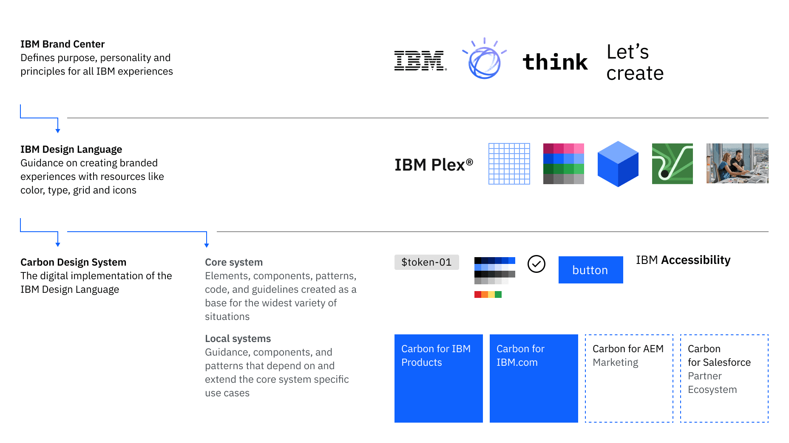

> Within IBM, every team that is building a digital experience is consuming Carbon
> assets and guidance but Carbon is more than one website.

### Quick Navigation

- [Overview](#overview)
- [Community assets](#community-assets)
- [Product](#product)
- [IBM.com](#ibm-com)
- [Brand](#brand)
- [IBMer Experience](#ibmer-experience)
- [Salesforce](#salesforce)
- [Conversational UX](#conversational-ux)

## Overview

At its core, Carbon has universal assets–elements, components, patterns, and
code–and guidance for how to design and build with them. These assets are
considered universal or fundamental in nature, which means they can be used as a
base for the widest variety of situations, and extended or adapted for the
specific business use cases.

Beyond this core is a distributed ecosystem of sites that support and serve the
design and development communities within IBM and, where open source content is
available, the external community as well.

The following sites within the Carbon community include guidance, assets, and
resources for all of IBM’s digital experiences from product to website. _Note
that some guidance is accessible to IBMers only._

*Caption: A diagram of the greater Carbon ecosystem.*

## Community assets

### Component index

These components are developed and maintained by members of the IBM Carbon
community. They may change over time, and they may be incomplete or in preview.
For support, please contact the maintainers listed on each page.

_Some of this content is accessible to IBMers only._

  
- 📄 [**Community component index**](/community/component-index/)

  </ResourceCard>

### Patterns

Patterns are best practice solutions for how a user achieves a goal. These
community patterns are developed and maintained by members of the Carbon
community. For support, contact the maintainers listed on each page.

_Some of this content is accessible to IBMers only._

  
- 📄 [**Community patterns**](/community/patterns/)

  </ResourceCard>

## Product

The guidance and resources here are for IBM product teams building software
applications and digital experiences with the Carbon Design System. This work is
built on the foundation of Carbon and provides solutions for specific domains
and use cases.

_This content is accessible to IBMers only._

  
- 📄 [**Sustainability Software Design**](https://pages.github.ibm.com/ai-applications/design/ai-apps-pal/about)

  
- 📄 [**Carbon for IBM Products**](https://pages.github.ibm.com/carbon/ibm-products/)

  
- 📄 [**Security Software Design**](https://pages.github.ibm.com/security/security-design/)

  
- 📄 [**Carbon React Native**](https://github.ibm.com/Aspera/carbon-react-native)

## IBM.com

The guidance and resources here have been developed for IBM teams building
digital experiences for the IBM.com site.

  
- 📄 [**Carbon for IBM.com**](https://www.ibm.com/standards/carbon/)

  
- 📄 [**Carbon for AEM**](https://pages.github.ibm.com/digital/interfaces/)

## Brand

The journey to understand IBM brand guidance begins with the foundations in the
Brand Center, then extends to the expression of brand as documented in the IBM
Design Language (IDL) site. From there, go to the IBM Brand Systems for visual
systems and guidance tailored to our hero brands, category brands, and
offerings.

_This content is accessible to IBMers only._

  
- 📄 [**IBM Brand Center**](https://www.ibm.com/brand/)

  
- 📄 [**IBM Design Language**](https://www.ibm.com/design/language/)

  
- 📄 [**IBM Brand Systems**](https://www.ibm.com/brand/systems)

## IBMer Experience

The guidance and resources here have been developed for IBM teams building
digital experiences internally for IBMer experiences such as CIO and HR.

  
- 📄 [**Carbon for IBMer Experience**](https://pages.github.ibm.com/w3-unified/ibmer-carbon-components/?path=/docs/introduction--docs)

## Salesforce

Carbon for Salesforce provides front-end developers & engineers a collection of
reusable LWC components to build websites and user interfaces. Adopting the
library enables developers to use consistent markup, styles, and behavior in
prototype and production work.

  
- 📄 [**Carbon for Salesforce**](https://carbon-for-salesforce.nnuka7gjzia.us-east.codeengine.appdomain.cloud/?path=/story/getting-started-welcome--page)

## Conversational UX

The IBM Natural Conversation Framework is for anyone designing or building
conversational agents. It provides design principles, interaction patterns, and
working code for the basic mechanics of natural conversation.

_This content is accessible to IBMers only._

  
- 📄 [**IBM Natural Conversation Framework**](https://alma.dal1a.ciocloud.nonprod.intranet.ibm.com/)

