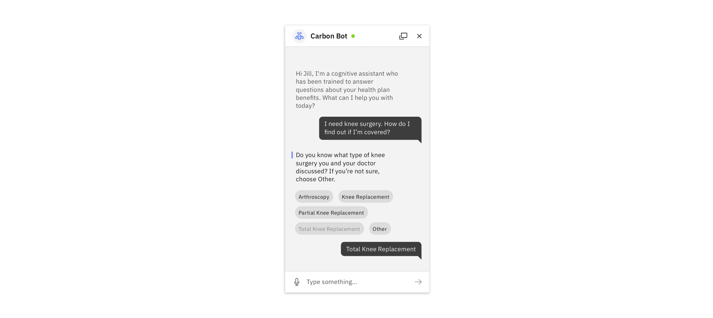

#### Maintainers:

[Sarah Liu](https://w3.ibm.com/bluepages/profile.html?uid=5G1630897)

#### Maintainers:

[Sarah Liu](https://w3.ibm.com/bluepages/profile.html?uid=5G1630897)

> Use a chatbot when a user would benefit from requesting information on-demand
> with natural language. They should receive a useful and trustworthy response
> related to their question or task.

### Quick Navigation

- [Common use cases](#common-use-cases)
- [User needs](#user-needs)
- [Why a chatbot?](#why-a-chatbot)
- [Supported components](#supported-components)
- [Chatbot add-on library](#chatbot-add-on-library)
- [More information](#more-information)

*Caption: Shown in Gray 10 Theme*

## Common use cases

Bots have become an increasingly popular way to solve common business problems
across domains, including:

- **Providing in-context help and guidance** (e.g., scaling a company's FAQ or
  helping a user get started)
- **Triaging or setting priority of cases** by soliciting information from the
  user to decrease workload on humans (support tickets, patient symptom
  severity)
- **Performing common tasks or procedures** (e.g., pay a bill, transfer money,
  or assist with electing health benefits)
- **Using natural language to search for information** (e.g., find specific
  information like current balance, or dosing instructions for a medication)

## Why a chatbot?

Before building a bot, make sure that you have justified it as an appropriate
solution by asking yourself these questions:

- What are the users' goals?
- How in-depth is the assistance the user will need?
- Is your domain better served by human assistance?
- How is a bot superior to online documentation, contextual support, wizards,
  etc.?
- What kind of data sources or abilities can this bot leverage for your business
  and your users?

## User needs

#### A user may need:

- Access to help at any time
- An on-demand, relevant answer to a question
- High quality, consistent information about a product or service

#### Within a conversation, a user may need:

- To provide the bot with more context via structured responses
- To know what the bot understands, through reflection and confirming questions
- To identify the most recent and relevant message to improve understanding

#### Don't use a chatbot when:

- A task could be accomplished more efficiently using a traditional user
  interface
- A process is very complex or could take a long time
- A real human is needed for sensitive or emotional topics

See
[IBM Design for Conversational AI](https://www.ibm.com/design/ai/conversation)
for more information.

## Supported components

While conversational interfaces may contain many different kinds of components,
Carbon currently offers these components out of the box to help get you up and
running quickly. See the Usage tab for information on how to use these
components together.

| Component             | Design status                            | Development status                               |
| --------------------- | ---------------------------------------- | ------------------------------------------------ |
| Chatbot window        |  `[Design available]`  |  `[Contribution needed]`  |
| Chatbot header        |  `[Design available]`  |  `[Contribution needed]`  |
| System message        |  `[Design available]`  |  `[Contribution needed]`  |
| User message          |  `[Design available]`  |  `[Contribution needed]`  |
| Structured response   |  `[Design available]`  |  `[Contribution needed]`  |
| Chatbot cards         |  `[Design available]`  |  `[Contribution needed]`  |
| Chatbot text input    |  `[Design available]`  |  `[Contribution needed]`  |
| Launch button         |  `[Design available]`  |  `[Contribution needed]`  |
| Welcome screen        |  `[Preview]`          |  `[Contribution needed]`  |
| Expandable card       |  `[Preview]`          |  `[Contribution needed]`  |
| Human message         |  `[Preview]`          |  `[Contribution needed]`  |
| List                  |  `[Coming soon]`    |  `[Contribution needed]`  |
| Launch button chips   |  `[Coming soon]`    |  `[Contribution needed]`  |
| Multiple threads menu |  `[Coming soon]`    |  `[Contribution needed]`  |

## Chatbot add-on library

To **add this library to Sketch with Sketch Cloud**, access the link below and
click "Add Library to Sketch." You will receive updates to chatbot symbols
automatically.

For **common chatbot sub-patterns, features or preview components**, click
"Download Document," open the document, and browse the relevant pages for
guidance related to your use case.

  
- 📄 [**Sketch library**](https://www.sketch.com/s/d6986eb8-bf0d-4695-abe8-9e79909d4518)
  </ResourceCard>

## More information

This collection of components is a living resource and the outcome of
partnerships with IBM product teams building and testing chatbot interactions.
Teams building with chatbots can use these components their work and contribute
validated interactions back to the chatbot pattern.
