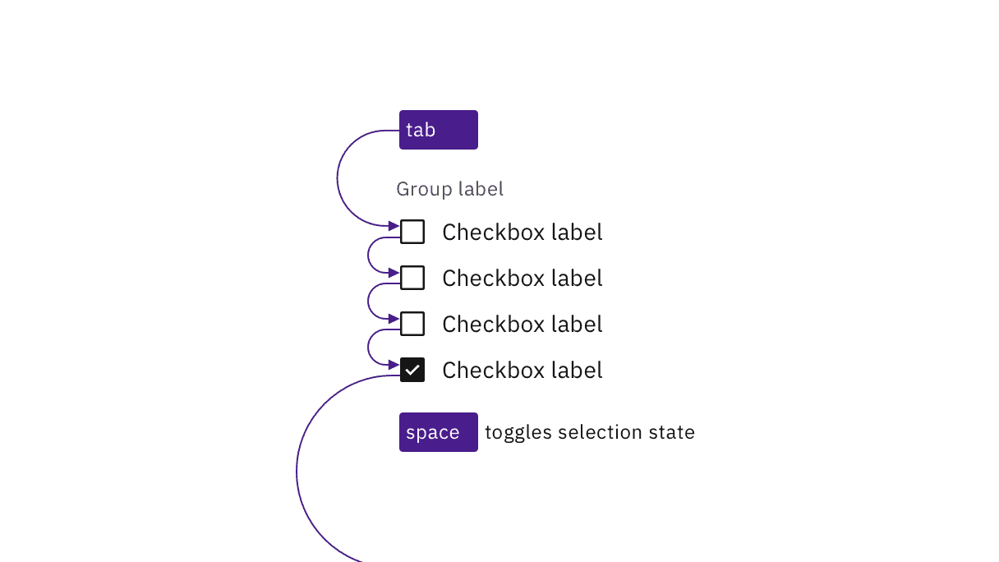
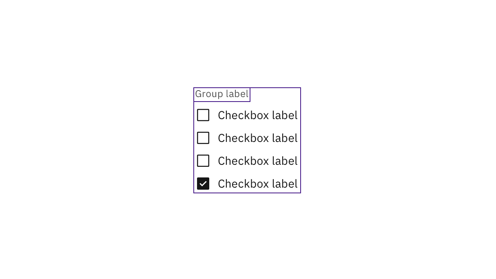
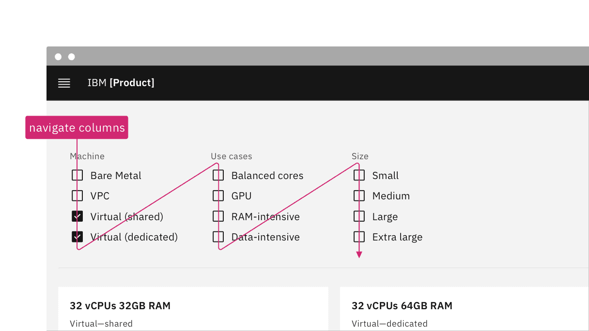

> Design annotations are needed for specific instances shown below, but for the
> standard checkbox component, Carbon already incorporates accessibility.

### Quick Navigation

- [What Carbon provides](#what-carbon-provides)
- [Design recommendations](#design-recommendations)
- [Development considerations](#development-considerations)

## What Carbon provides

Carbon bakes keyboard operation into its components, improving the experience of
blind users and others who operate via the keyboard. Carbon incorporates many
other accessibility considerations, some of which are described below.

### Keyboard interactions

Each checkbox can be reached by `Tab` and selected with `Space` independently.
This matches the established HTML interaction pattern.

*Caption: Carbon checkboxes retain expected interactions.*

### Grouping

For groups of checkboxes, Carbon already provides the code for screen readers to
properly detect the set of checkboxes and announce the group label.

*Caption: Carbon handles the accessibility of grouped checkboxes.*

## Design recommendations

Design annotations are needed for the following instances.

### Meaningful order

Checkboxes can appear in multiple columns. If there is a meaningful order to the
items (such as days of the week), annotate whether the tab order is by row or by
column. See
[Specify the tab order](https://www.ibm.com/able/toolkit/design/ux/navigation/#tab-order).

*Caption: Annotate if there is meaningful navigation order in rows of checkboxes.*

## Development considerations

Keep these considerations in mind if you are modifying Carbon or creating a
custom component:

- Checkboxes are grouped using `<fieldset>` and `<legend>`.
- A tri-state checkbox that is partially checked (indeterminate) has
  `aria-checked` set to `"mixed"`. See
  [Behaviors](https://carbondesignsystem.com/components/checkbox/usage/#behaviors)
  on the Usage tab for details.
- See the
  [ARIA authoring practices](https://www.w3.org/TR/wai-aria-practices-1.2/#checkbox)
  for more considerations.

> ♿ **Accessibility Status:** Component audited for WCAG 2.1 AA accessibility standards.

