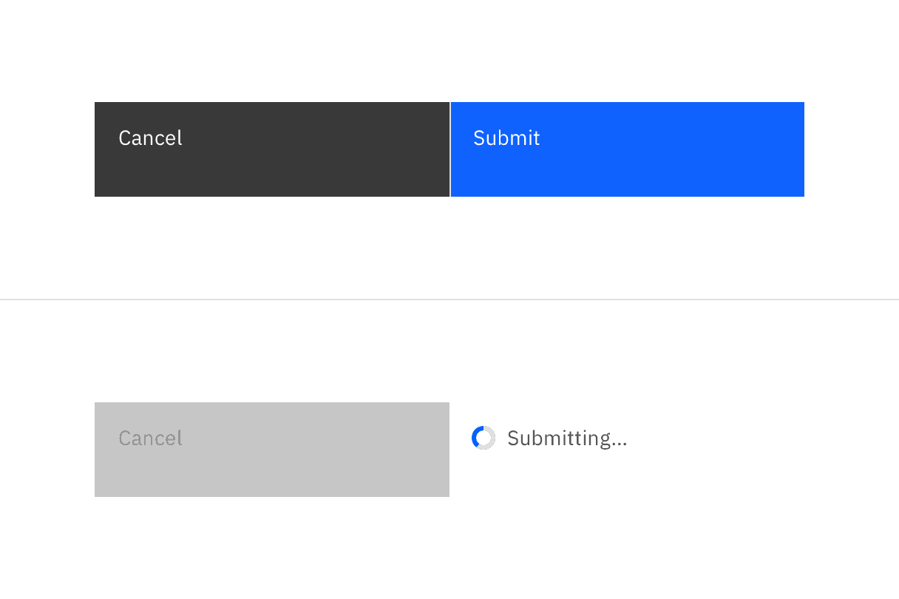
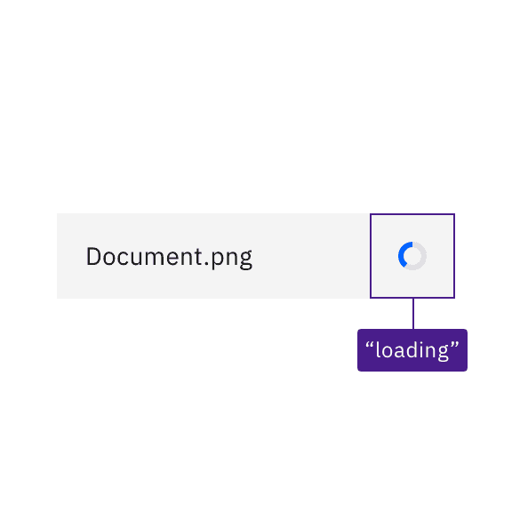

> No accessibility annotations are needed for inline loading components, but keep
> these considerations in mind if you are modifying Carbon or creating a custom
> component.

### Quick Navigation

- [What Carbon provides](#what-carbon-provides)
- [Development considerations](#development-considerations)

## What Carbon provides

Carbon bakes keyboard operation into its components, improving the experience of
blind users and others who operate via keyboard. Carbon also incorporates other
accessibility considerations, some of which are described below.

### Keyboard interaction

The inline loading component is not keyboard operable; however, when inline
loading is in an active state, it may temporarily replace or disable an
associated component. For instance, if inline loading is showing the result of a
button action, relevant input controls as well as other actions may be disabled
and inoperable until the loading state changes to either error or complete.

*Caption: Inline loading components are not interactive, but may temporarily disable
  dependent components.*

### Labeling and states

Where there is displayed text for inline loading, Carbon provides the text as
the status to assistive technologies like screen readers. Where there is no
text, Carbon provides a text equivalent (“loading”) for the loading symbol.

  
> [!TIP] **DO: Inline loading text is provided to assistive technologies.**
> 

  
> [!TIP] **DO: Where there is no text, Carbon provides a text equivalent for the loading symbol.**
> 

## Development considerations

Keep these considerations in mind if you are modifying Carbon or creating a
custom component.

- Carbon uses an `aria-live` region set to “polite” to surface inline loading
  text messages, where they are used.
- Where no text is displayed for inline loading, Carbon uses the SVG title of
  the status icon to surface the status (“active”, “finished”, “error”) to
  assistive technologies.

> ♿ **Accessibility Status:** Component audited for WCAG 2.1 AA accessibility standards.

