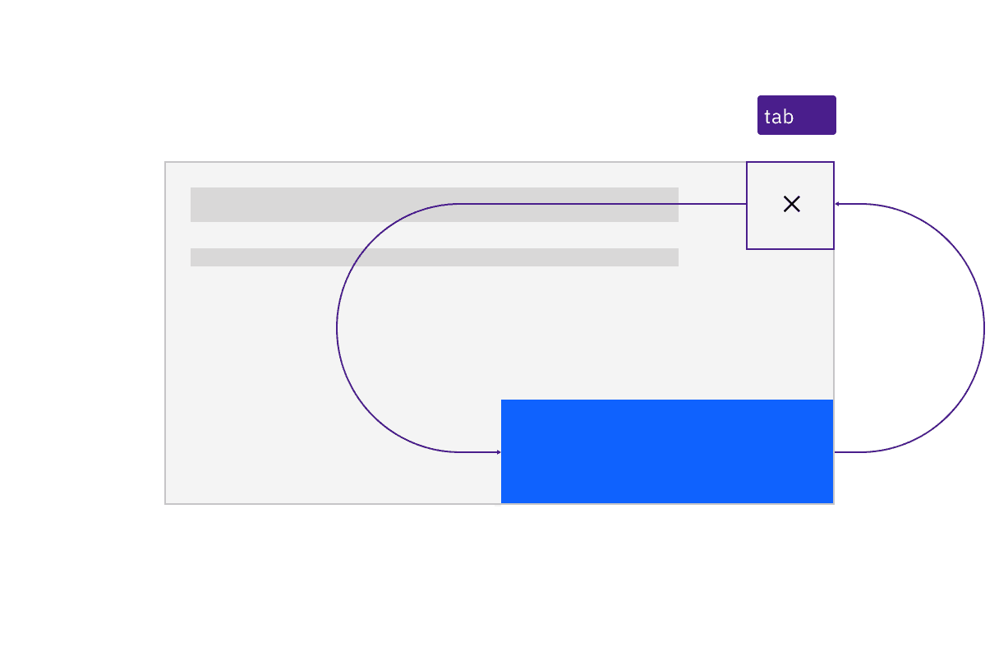
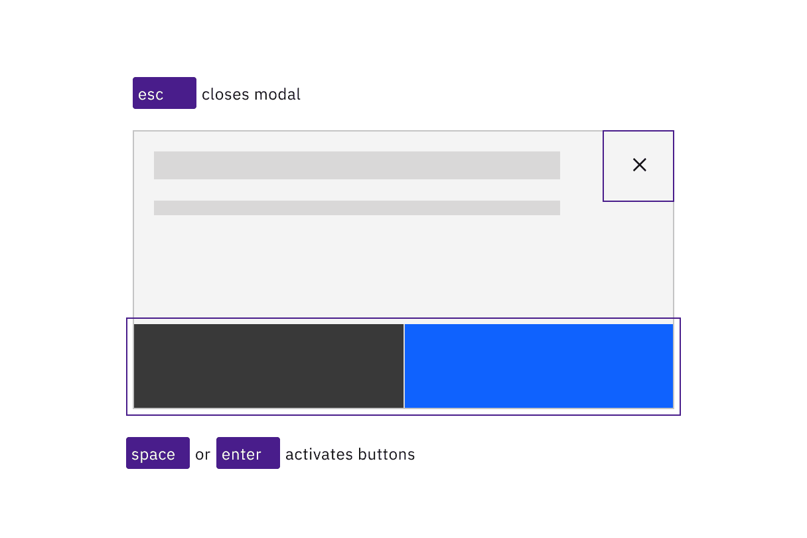
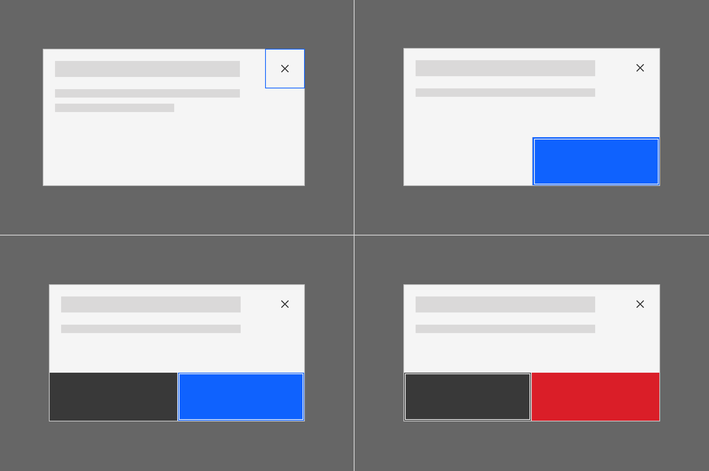
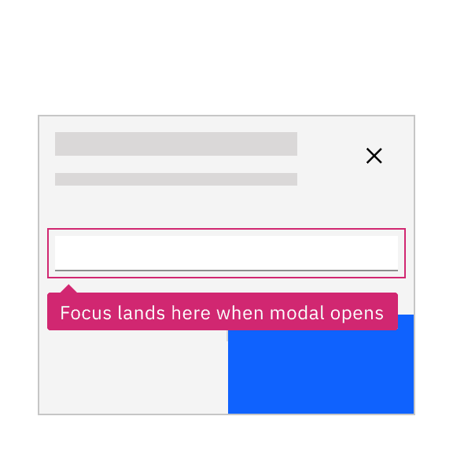
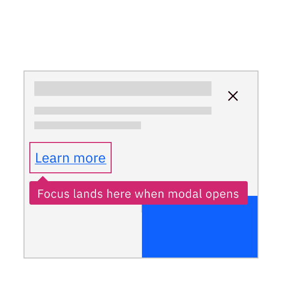

> Design annotations are needed for specific instances shown below, but for the
> standard modal dialog component, Carbon already incorporates accessibility.

### Quick Navigation

- [What Carbon provides](#what-carbon-provides)
- [Design recommendations](#design-recommendations)
- [Development considerations](#development-considerations)

## What Carbon provides

Carbon bakes keyboard operation into its components, improving the experience of
blind users and others who operate via the keyboard. Carbon incorporates many
other accessibility considerations, some of which are described below.

### Keyboard interactions

Modal dialogs take focus on appearance, and the tab order is constrained to the
modal’s controls until the modal is closed by choosing one of the buttons with
`Enter` or `Space`, or is dismissed by pressing `Esc`.

*Caption: Keyboard navigation is constrained to the dialog. Tab cycles through the
  components that take focus.*

*Caption: The dialog is resolved by the user pressing Esc or activating a button.*

### Focus handling

When the dialog appears, the first item that gets focus depends on the type of
dialog. Passive dialogs only contain a close button (X), so that takes focus.
For dialogs which prompt for confirmation or user decision, the primary button
takes focus (regardless of number of buttons). For destructive interactions, the
“cancel” button takes focus, not the red danger/delete button. The tab order
should proceed left and down from whichever item has focus then wrap back to the
close button (X).

*Caption: The first item with focus varies depending on dialog type.*

## Design recommendations

### Designate the input that takes focus in a transactional

The only time the starting focus would not be on a button is where a dialog
contains input fields. For such transactional dialogs, designers should annotate
that the first input field should receive focus. Note that text links are not
considered a user input in this context.

  
> [!TIP] **DO: Annotate the starting input that should take focus on a transactional dialog.**
> 

  
> [!WARNING] **DON'T: Do not give a link focus when a modal opens.**
> 

## Development considerations

Keep these considerations in mind if you are modifying Carbon or creating a
custom component.

- Carbon assigns the container a role of "dialog" and sets `aria-modal` to
  `"true"`.
- The dialog is labelled via `aria-label`, using the same string used for the
  modal’s title; `aria-labelledby` could also be used to assign the title’s
  string.
- See the modal pattern in the
  [ARIA authoring practices](https://w3c.github.io/aria-practices/#dialog_modal)
  for more considerations.

> ♿ **Accessibility Status:** Component audited for WCAG 2.1 AA accessibility standards.

