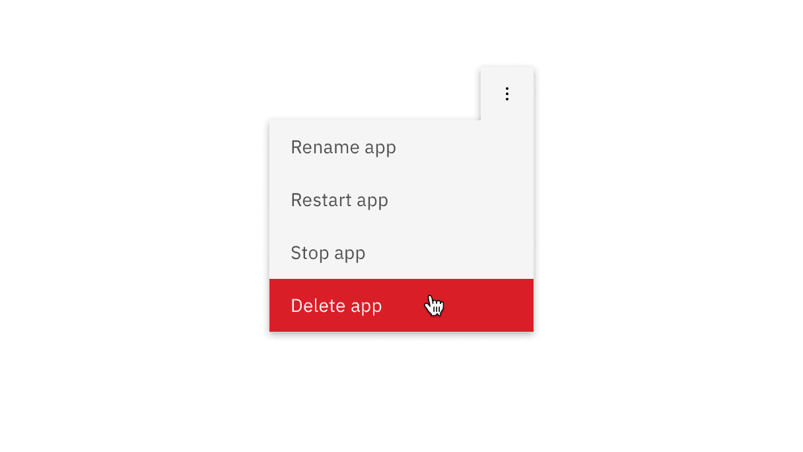
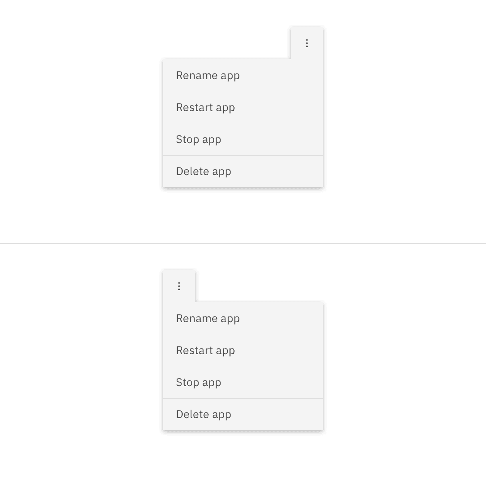

> Use the overflow menu component when additional options are available to the
> user but there is a space constraint.

### Quick Navigation

- [Live demo](#live-demo)
- [Overview](#overview)
- [Formatting](#formatting)
- [Feedback](#feedback)

## Overview

Overflow menu is used when additional options are available to the user and
there is a space constraint.

## Live demo

> 🔗 **Interactive Live Demo:** [Carbon React Storybook](https://react.carbondesignsystem.com)

## Formatting

#### Text

The text within an overflow menu should be direct so users can quickly decide on
an action. Actions that could cause a significant change to the user's data
(delete app, delete service, etc.) are separated by a divider and live below the
primary set of actions.

### Placement

Depending on where the Overflow menu appears within the UI, the tab tip may
appear on the left or right so it always remains visible.

## Feedback

Help us improve this component by providing feedback, asking questions, and
leaving any other comments on
[GitHub](https://github.com/carbon-design-system/carbon-website/issues/new?assignees=&labels=feedback&template=feedback.md).
