> Start by identifying the purpose of the visualization and then choose the
> appropriate chart type.

## Comparisons

 
### [Simple bar](/data-visualization/simple-charts#bar-(simple))

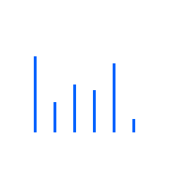

 
### [Grouped bar](/data-visualization/simple-charts#bar-(grouped))

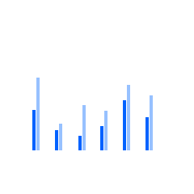

 
### [Floating bar](/data-visualization/simple-charts#bar-(floating))

 
### [Lollipop](/data-visualization/simple-charts#lollipop)

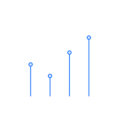

 
### [Bubble](/data-visualization/simple-charts#bubble)

 
### [Radar](/data-visualization/simple-charts#radar)

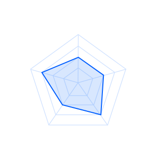

 
### [Wordcloud](/data-visualization/simple-charts#word-cloud)

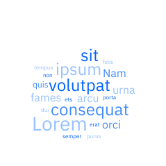

## Trends

 
### [Line](/data-visualization/simple-charts#line)

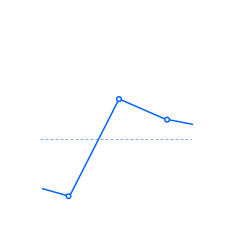

 
### [Area](/data-visualization/simple-charts#area-(simple))

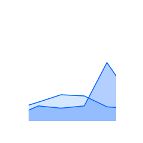

 
### [Boxplot](/data-visualization/simple-charts#boxplot)

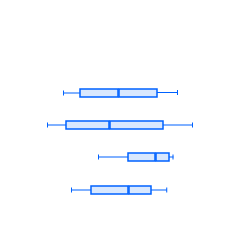

 
### [Histogram](/data-visualization/simple-charts#histogram)

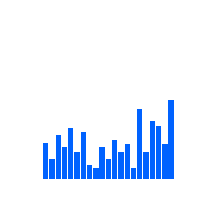

 
### [Stream](#)

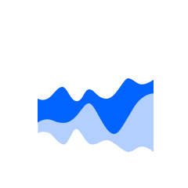

## Part-to-whole

 
### [Donut](/data-visualization/simple-charts#donut)

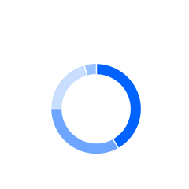

 
### [Pie](/data-visualization/simple-charts#pie)

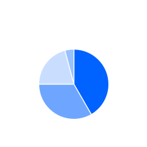

 
### [Stacked bar](/data-visualization/simple-charts/#bar-(stacked))

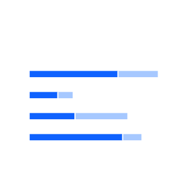

 
### [Bullet](/data-visualization/simple-charts/#bullet)

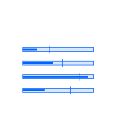

 
### [Stacked area](/data-visualization/simple-charts/#area-(stacked))

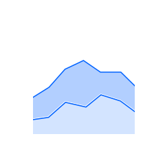

### [Meter](/data-visualization/simple-charts/#meter)

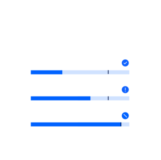

### [Gauge](/data-visualization/simple-charts/#gauge)

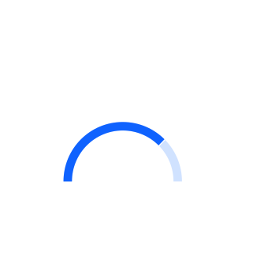

 
### [Tree map](/data-visualization/spatial-charts/#tree-maps)

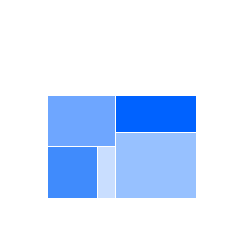

 
### [Circle pack](/data-visualization/spatial-charts/#circle-packs)

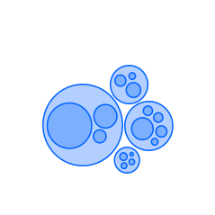

## Correlations

 
### [Scatter](/data-visualization/simple-charts#scatter)

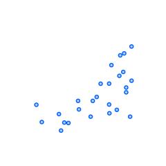

 
### [Heat map](/data-visualization/spatial-charts/#heat-maps)

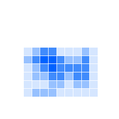

 
### [Parallel coordinates](/data-visualization/flow-charts/#parallel-coordinates)

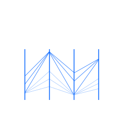

## Connections

 
### [Alluvial diagram](/data-visualization/flow-charts/#alluvialsankey-diagrams)

 
### [Network diagram](/data-visualization/flow-charts/#network-diagrams)

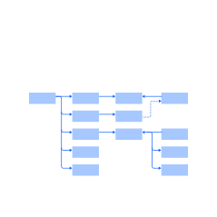

 
### [Tree diagram](/data-visualization/flow-charts/#tree-diagrams)

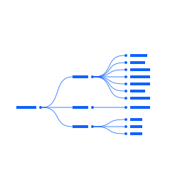

## Geospatial: overlays

 
### [Choropleth map](/data-visualization/spatial-charts/#geospatial-charts)

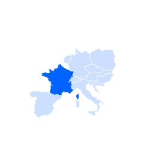

 
### [Proportional symbol](/data-visualization/spatial-charts/#proportional-symbol-map)


 
### [Connection map](/data-visualization/spatial-charts/#connection-map)


