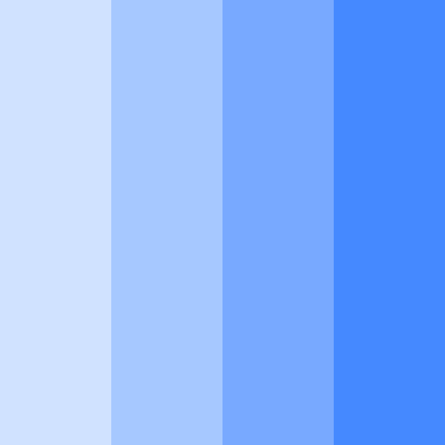
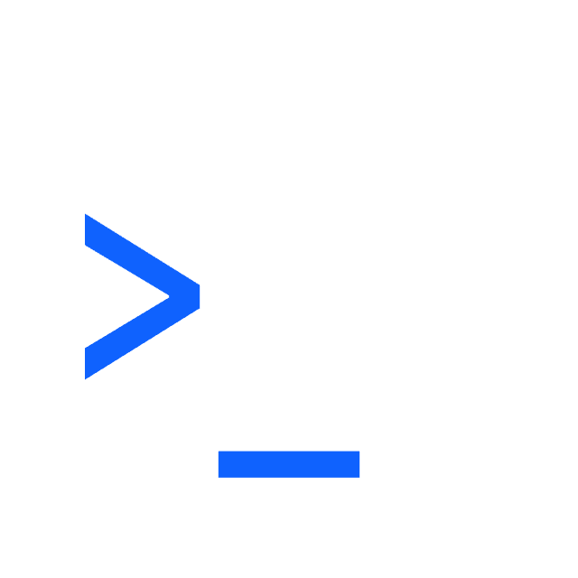
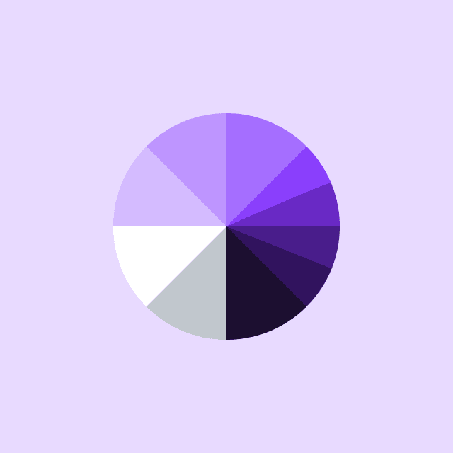

export default HomepageTemplate;

    
  
### [Design](https://carbondesignsystem.com/designing/get-started)

    
### [Develop](https://carbondesignsystem.com/developing/get-started)

      
### [Migrate](https://carbondesignsystem.com/migrating/guide/overview/)

### Learn about Carbon

New to Carbon? Take a moment to explore what we're all about.

  
    
- 📄 [**What is Carbon?**](/all-about-carbon/what-is-carbon/)
    </ResourceCard>
  
  
    
- 📄 [**The Carbon ecosystem**](/all-about-carbon/the-carbon-ecosystem/)
    </ResourceCard>
  

### Explore libraries

The component libraries give developers and designers a collection of reusable
components for building websites and user interfaces.

  
- 📄 [**Figma kit**](/designing/kits/figma)
  </ResourceCard>
  

  
- 📄 [**Sketch kits**](/designing/kits/sketch)
  </ResourceCard>

  
- 📄 [**Carbon React components**](https://github.com/carbon-design-system/carbon/tree/main/packages/react)

  </ResourceCard>

  
- 📄 [**Carbon Angular components**](https://github.com/IBM/carbon-components-angular)

  </ResourceCard>

  
- 📄 [**Carbon Vue components**](https://github.com/carbon-design-system/carbon-components-vue)

  </ResourceCard>

  
- 📄 [**Carbon Svelte components**](https://github.com/IBM/carbon-components-svelte)
  </ResourceCard>

  
- 📄 [**Carbon Web Components**](https://github.com/carbon-design-system/carbon/tree/main/packages/web-components)
  </ResourceCard>

### Latest news and articles

