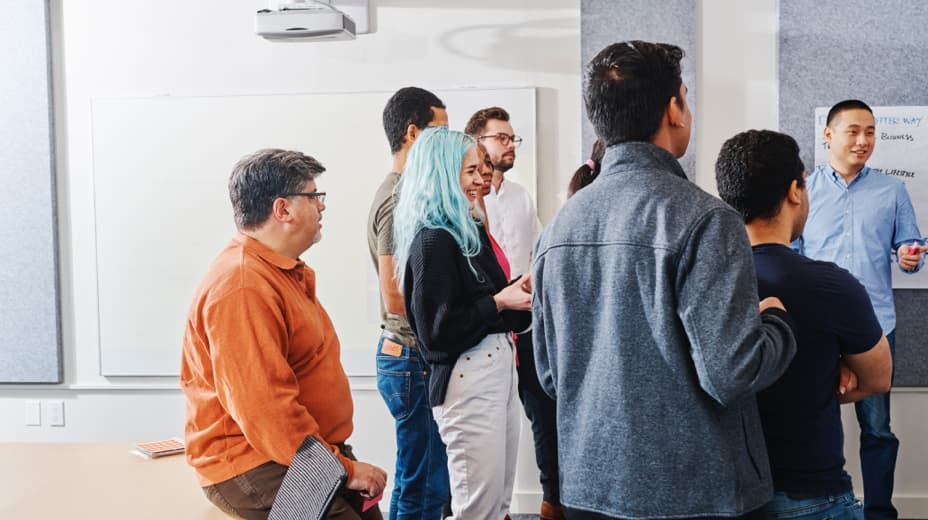

> The Carbon team is committed to helping members of the IBM community be
> successful. Find meetups for leveling up your skills, connecting with your
> peers, and getting reviews on work in progress.

## Carbon Office Hours

A once a sprint meeting for teams building with Carbon to ask questions, learn
about best practices, and bring up things the Carbon team can do to make their
jobs easier.

  <Button
    kind="tertiary"
    renderIcon={Launch}
    href="https://ec.yourlearning.ibm.com/w3/series/10289694?layout=grid">
    Subscribe
  </Button>

{/* prettier-ignore */}
<h2>Design pin-upsContact us to schedule</h2>

_For IBMers only:_ Put your screens up in MURAL and step through the flow and
page designs with the Carbon designers. Great for assessing the overall flow,
page layouts, the best choices and use of components, content—everything from
the big picture to the smallest detail! Usually two or more hours.

  <Button
    kind="tertiary"
    renderIcon={ArrowRight}
    onClick={() => (window.location.href = 'mailto:carbon@us.ibm.com')}>
    Email us
  </Button>

