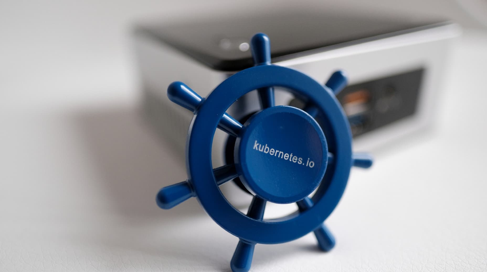
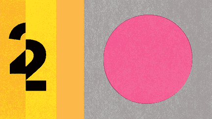
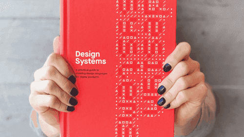
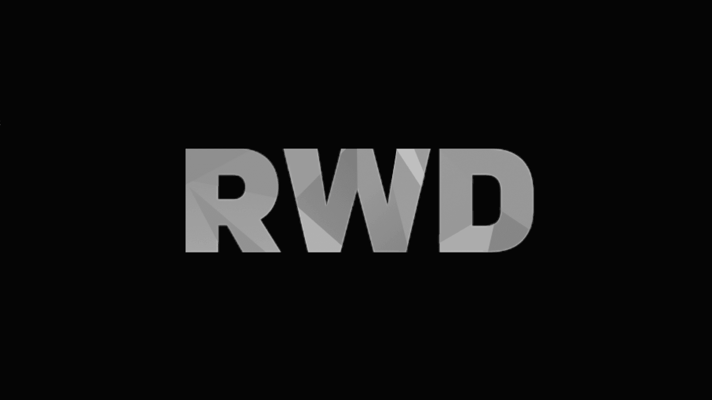
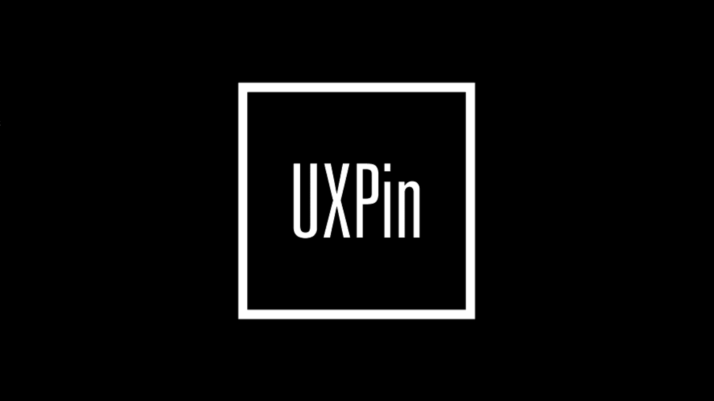

> Learn about some of Carbon's bigger projects and read other articles of interest
> about design systems.

### Quick Navigation

- [Latest news](#latest-news)
- [Books and articles](#books-and-articles)

## Latest news

## Books and articles

### [Design + Open Source](https://medium.com/design-ibm/design-open-source-lessons-from-a-year-of-contributing-to-the-kubernetes-project-a85120acc890)

  
### [Writing Is Designing](https://rosenfeldmedia.com/books/writing-is-designing/)

  
### [Smashing Magazine’s “Design Systems” Book](https://www.smashingmagazine.com/design-systems-book/)

  
### [Path to Design System Maturity](https://medium.com/ux-power-tools/the-path-to-design-system-maturity-d403daba692a)

  
### [Responsive Web Design Podcast](https://responsivewebdesign.com/podcast/ibm-carbon/)

  
### [UX Pin Virtual Design Summit](https://www.youtube.com/watch?v=eSvq5MieOdw&t=144s)

