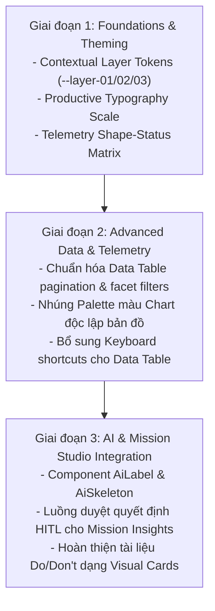

# Carbon Design System vs. SkyTrack UI: Phân Tích & Định Hướng Nâng Cấp

> **Tài liệu tham chiếu:** [`designs/components/skytrack-ui/docs/carbon-ds-reference/`](file:///Users/tuan.tg/Documents/Tuan'sVault/obsidian-resources/03_Work/Projects/SkyTrack/designs/components/skytrack-ui/docs/carbon-ds-reference)  
> **Hệ thống đích:** [`designs/components/skytrack-ui/`](file:///Users/tuan.tg/Documents/Tuan'sVault/obsidian-resources/03_Work/Projects/SkyTrack/designs/components/skytrack-ui)  
> **Cập nhật:** 2026-11-03

---

## Mục Lục Điều Hướng

- [Topic 1: Ma trận So sánh Toàn diện](#topic-1-ma-trận-so-sánh-toàn-diện)
- [Topic 2: Kiến trúc Token & Contextual Layering](#topic-2-kiến-trúc-token--contextual-layering)
- [Topic 3: Telemetry, Chỉ báo Trạng thái & Data Visualization](#topic-3-telemetry-chỉ-báo-trạng-thái--data-visualization)
- [Topic 4: Mô hình Tương tác AI (Carbon for AI -> SkyTrack HITL)](#topic-4-mô-hình-tương-tác-ai-carbon-for-ai---skytrack-hitl)
- [Topic 5: Typography & Mật độ Thông tin (Productive Type Scale)](#topic-5-typography--mật-độ-thông-tin-productive-type-scale)
- [Topic 6: Ma trận Quyết định: Điểm Nên Học vs. Không Nên Học](#topic-6-ma-trận-quyết-định-điểm-nên-học-vs-không-nên-học)
- [Topic 7: Lộ trình Triển khai Đề xuất cho SkyTrack UI](#topic-7-lộ-trình-triển-khai-đề-xuất-cho-skytrack-ui)
- [Topic 8: Kế hoạch Bổ sung Guidelines, Foundations & Patterns Còn Thiếu](#topic-8-kế-hoạch-bổ-sung-guidelines-foundations--patterns-còn-thiếu)

---

## Topic 1: Ma trận So sánh Toàn diện

So sánh đa chiều giữa hệ thống Enterprise toàn cầu (Carbon) và thư viện chuyên dụng cho điều khiển bay UAV (SkyTrack UI):

| Chiều phân tích | Carbon Design System (IBM v11) | SkyTrack UI (Base UI + Tailwind v4) | Đánh giá & Khoảng cách |
| :--- | :--- | :--- | :--- |
| **1. Định vị & Miền sử dụng** | Enterprise Platform đa ngành: Cloud consoles, AI platforms, ERP, IT Ops, Marketing. | Chuyên dụng (Domain-specific): Điều khiển UAV, lập kế hoạch bay 3D, phân tích dữ liệu trắc địa, Mission Studio. | Carbon bao quát rộng nhưng cồng kềnh; SkyTrack UI tập trung sâu vào tác vụ vận hành thực địa. |
| **2. Nền tảng Kỹ thuật** | Monorepo đa framework (React, Web Components, Angular, Vue, Svelte). SCSS modules, CSS custom properties. | React 19 + [Base UI](https://base-ui.com) (Headless primitives) + Tailwind CSS v4. Pure TypeScript. | SkyTrack UI kiến trúc hiện đại, nhẹ, build nhanh và linh hoạt hơn nhiều so với SCSS monorepo của Carbon. |
| **3. Phân tầng Màu sắc (Theming)** | 4 Themes: `White`, `Gray 10` (Light) và `Gray 90`, `Gray 100` (Dark). Tokens phân tầng ngữ cảnh 3 lớp (`$layer-01/02/03`). | 1 Dark Theme chủ đạo (hỗ trợ Light sơ khai). CSS variables (`--background`, `--card`, `--sidebar`, `--primary`). | Carbon vượt trội về cơ chế lồng lớp Dark Mode. SkyTrack UI chưa có layer token chuẩn cho các panel lồng nhau. |
| **4. Bố cục & Lưới (Grid)** | 2x Grid chuẩn 16 cột, mini-unit 4px/8px, margin và gutter cố định/linh hoạt theo breakpoint. | CSS Grid / Flexbox tùy biến theo Viewport không gian (Cesium 3D canvas) + Floating HUD + Docking panels. | Grid 16 cột của Carbon không phù hợp layout bản đồ 3D; SkyTrack cần bố cục theo vùng chức năng không gian. |
| **5. Kiểu chữ (Typography)** | IBM Plex (Sans, Mono, Serif). Phân tách: *Productive* (app dữ liệu dày) & *Expressive* (landing, web đọc). | IBM Plex Sans & IBM Plex Mono. Kế thừa Swiss Modernism, nhấn mạnh độ chính xác, tương phản cao. | Cùng chung nền tảng IBM Plex, nhưng Carbon chuẩn hoá quy tắc line-height và tracking chặt chẽ hơn. |
| **6. Hệ sinh thái Component** | 44+ core components, thư viện biểu đồ đồ sộ (`@carbon/charts`), bộ UI Shell phức hợp. | 51 public components (bao gồm cả các điều khiển đặc thù: PageHeader, Attachment, Dropzone, DatePicker...). | Số lượng tương đương; Carbon mạnh về data grid/table, SkyTrack mạnh về điều khiển form và dialog hiện đại. |
| **7. Biểu đồ & Dữ liệu lớn** | Rất mạnh: 26+ dạng chart, palette màu trực quan hóa chuẩn WCAG, hỗ trợ tooltip/legend đa trạng thái. | Mới ở mức cơ bản: Component `chart.tsx` bọc Recharts, đang thử nghiệm palette màu riêng. | Cần học hỏi trực tiếp bộ palette màu và quy tắc anatomy biểu đồ từ Carbon Data Viz. |
| **8. Khả năng tiếp cận (A11y)** | Chuẩn WCAG 2.1 AA tối đa: Kiểm toán phím tab, phím mũi tên, screenreader status cho 100% component. | Thừa hưởng nền tảng Base UI (WAI-ARIA compliance tự nhiên), nhưng tài liệu chưa công bố bảng phím tắt rõ ràng. | Carbon có ma trận phím tắt và kịch bản test screenreader chi tiết hơn. |
| **9. Tích hợp AI / Agent** | Có Carbon MCP server để AI tra cứu/audit token runtime; bộ guideline `carbon-for-ai` chuẩn hoá. | Quản lý qua rule policy nội bộ ([`UI_RULES.md`](file:///Users/tuan.tg/Documents/Tuan'sVault/obsidian-resources/03_Work/Projects/SkyTrack/designs/components/skytrack-ui/skills/skytrack-ui/references/UI_RULES.md)) và checker gate; chưa có MCP runtime server. | Carbon đi trước về tooling cho AI code generation và mẫu thiết kế nhãn AI. |
| **10. Tài liệu hướng dẫn** | 4 tab tiêu chuẩn hóa cho mỗi component: Usage, Style, Code, Accessibility + Do/Don't trực quan. | Showcase tương tác 4 view (Components, Sheet, Style overview, Dashboard) + 51 file markdown knowledge. | SkyTrack UI tài liệu phong phú nhưng cấu trúc Do/Don't chưa trực quan bằng Carbon. |

---

## Topic 2: Kiến trúc Token & Contextual Layering

### 1. Phân tích Mô hình Contextual Layering của Carbon
Trong giao diện Dark Mode dày đặc dữ liệu, nếu chỉ có 1 màu nền `--background` và 1 màu `--card`, các hộp chứa lồng nhau (Nested Containers) sẽ bị bẹt dí, mất cảm giác phân cấp chiều sâu.

Carbon giải quyết triệt để bằng **Mô hình Token Ngữ cảnh 3 Lớp**:

```text
[ $background (G100: #161616) ] ---------------------------- (Mặt bàn / Canvas)
   └── [ $layer-01 (G90: #262626) ] ------------------------- (Panel chính / Sidebar)
          └── [ $layer-02 (G80/G70) ] ----------------------- (Card lồng trong Panel)
                 └── [ $layer-03 (G60) ] -------------------- (Input field / Modal lồng trong Card)
```

- **Quy tắc Carbon**: Khi một component nằm bên trong `$layer-01`, nó tự động nhận các token phụ trợ tương ứng (`$field-01`, `$border-subtle-01`). Khi nằm trong `$layer-02`, nó đổi sang `$field-02`.

### 2. Áp dụng cho SkyTrack UI
Mission Studio có cấu trúc lồng lớp điển hình:
1. **Lớp 0 (Base Canvas)**: Màn hình 3D bản đồ vệ tinh / Cesium Viewport (`--canvas-bg`).
2. **Lớp 1 (Docked Shell)**: Sidebar trái, Inspector panel phải, Header (`--layer-01` / `--sidebar`).
3. **Lớp 2 (Surface Cards)**: Thẻ danh sách drone, Flight plan summary cards (`--layer-02` / `--card`).
4. **Lớp 3 (Floating HUD & Overlays)**: Popup waypoint, dialog xác nhận bay khẩn cấp, mini-inspectors (`--layer-03` / `--popover`).

> [!TIP] **Khuyến nghị cho SkyTrack UI**
> Bổ sung bộ 3 biến ngữ cảnh vào [`styles.css`](file:///Users/tuan.tg/Documents/Tuan'sVault/obsidian-resources/03_Work/Projects/SkyTrack/designs/components/skytrack-ui/src/styles.css):
> ```css
> --layer-01: var(--color-gray-950); /* #12151c - Docking Panels */
> --layer-02: var(--color-gray-900); /* #1a1f2c - Cards, Inspectors */
> --layer-03: var(--color-gray-850); /* #242b3d - Nested inputs, Popovers */
> ```

---

## Topic 3: Telemetry, Chỉ báo Trạng thái & Data Visualization

### 1. Chuẩn hoá Hệ thống Chỉ báo Trạng thái (Severity Indicators)
Người điều khiển bay thường xuyên phải quan sát màn hình trong điều kiện ánh sáng mạnh hoặc bị chói. Carbon sử dụng quy tắc kép: **Màu sắc + Hình khối (Shape Identification)** để đảm bảo người mù màu hoặc môi trường chói nắng vẫn nhận biết tức thì:

| Cấp độ | Màu Carbon | Hình khối Icon | Ứng dụng Telemetry SkyTrack |
| :--- | :--- | :--- | :--- |
| **Success** | Green 50 (`#24a148`) | Hình tròn + Dấu kiểm (`CheckmarkFilled`) | RTK Fixed, GPS 3D Lock, Pin > 60%, Link tín hiệu tốt. |
| **Info** | Blue 60 (`#0f62fe`) | Hình tròn + Chữ i (`InformationFilled`) | Chế độ bay tự động (Autonomous), Đang tải Waypoint. |
| **Warning** | Yellow 30 (`#f1c21b`) | Hình tam giác (`WarningAltFilled`) | Gió mạnh cấp 4, Pin < 30%, Mất kết nối phụ (RC backup). |
| **Error / Alert** | Red 60 (`#da1e28`) | Hình tròn viền đỏ (`ErrorFilled`) | Mất kết nối RTK (Float), Geofence Breach, Pin < 15%. |
| **Fatal / Emergency**| Red 70 (`#ba1b23`) | Hình bát giác (`StopFilledAlt`) | Động cơ quá nhiệt, Rơi tự do, Mất tín hiệu khẩn cấp (Failsafe). |

### 2. Palette Màu cho Biểu đồ (Data Visualization)
SkyTrack cần trực quan hóa: Độ cao (Elevation), Vận tốc bay (Airspeed), Dung lượng pin theo thời gian, Nhiệt độ cell pin.

- **Vấn đề**: Dùng màu ngẫu nhiên dễ xung đột với màu xanh lá cây/xanh biển của bản đồ vệ tinh.
- **Vay mượn từ Carbon**:
  - Dùng **Categorical Palette 5 màu** chuẩn của IBM: Magenta, Cyan, Purple, Teal, Orange. Các màu này tách biệt hoàn toàn khỏi màu địa hình vệ tinh thông thường.
  - Áp dụng bảng màu phân kỳ (Diverging Palette) cho biểu đồ độ dốc địa hình / cao độ bay an toàn (DEM/DSM).

---

## Topic 4: Mô hình Tương tác AI (Carbon for AI -> SkyTrack HITL)

Carbon cung cấp bộ tiêu chuẩn tương tác AI chính thống nhất hiện nay ([`carbon-for-ai`](file:///Users/tuan.tg/Documents/Tuan'sVault/obsidian-resources/03_Work/Projects/SkyTrack/designs/components/skytrack-ui/docs/carbon-ds-reference/guidelines/carbon-for-ai/index.md)). Đây là mảnh ghép SkyTrack UI đang cần cho **Mission Insights (T-368/T-369)**:

### 1. Nhận diện Minh bạch (AI Attribution)
- **`AI Label`**: Component dạng huy hiệu nhỏ gắn vào tiêu đề của gợi ý:
  - Báo hiệu cho phi công biết waypoint hoặc lộ trình này do thuật toán AI tự đề xuất, không phải do con người vẽ thủ công.
  - Click vào mở popover giải thích cơ sở dữ liệu: *"Đề xuất giảm độ cao 15m để tránh vùng gió giật 40km/h dựa trên cảm biến trạm mặt đất"*.

### 2. Trạng thái Đang Suy luận (AI Skeleton)
- Khi AI đang tính toán tối ưu hoá đường bay phức tạp, Carbon dùng hiệu ứng gradient shimmer đặc trưng cho `AI Skeleton`, phân biệt với skeleton tải dữ liệu backend thông thường.

### 3. Cơ chế Can thiệp của Con người (Human-in-the-loop - HITL)
- Mọi khuyến nghị của AI luôn đi kèm 3 hành động tiêu chuẩn:
  1. **Accept / Apply**: Phê duyệt đưa vào kế hoạch bay chính thức.
  2. **Modify**: Giữ nguyên cơ sở gợi ý nhưng cho phép phi công kéo thả lại waypoint.
  3. **Dismiss / Feedback**: Hủy bỏ và ghi nhận lý do phi công từ chối (dữ liệu học tăng cường).

---

## Topic 5: Typography & Mật độ Thông tin (Productive Type Scale)

Carbon phân định rõ ràng giữa **Productive** và **Expressive**:
- **Productive**: Ưu tiên không gian làm việc hẹp, số liệu dày, bảng điều khiển, hạn chế cuộn trang.
- **Expressive**: Ưu tiên nhịp điệu đọc thoải mái, trang giới thiệu, onboarding.

SkyTrack UI sử dụng IBM Plex Sans và IBM Plex Mono, hoàn toàn tương thích để áp dụng trực tiếp thang tỷ lệ **Productive**:

| Style Name | Font Size | Line Height | Tracking | Ứng dụng trong SkyTrack UI |
| :--- | :--- | :--- | :--- | :--- |
| `label-01` | 12px (0.75rem) | 16px (1.33) | +0.32px | Tiêu đề telemetry (Alt, Spd, Batt), nhãn cột Data Table. |
| `helper-text-01` | 12px (0.75rem) | 16px (1.33) | 0px | Chú thích dưới input tọa độ, đơn vị đo lường (m, km/h, %). |
| `body-compact-01` | 14px (0.875rem) | 18px (1.28) | +0.16px | Nội dung hàng bảng dữ liệu, danh sách waypoint, logs. |
| `heading-compact-01` | 14px (0.875rem) | 18px (1.28) | +0.16px | Tiêu đề card nhỏ, heading trong inspector panel. |
| `heading-compact-02` | 16px (1.0rem) | 22px (1.37) | 0px | Tiêu đề panel lớn, Section Header của Mission Studio. |
| `code-01` (Mono) | 12px (0.75rem) | 16px (1.33) | 0px | Tọa độ GPS (`Lat/Lon/Alt`), mã lỗi hệ thống, MAVLink packets. |

---

## Topic 6: Ma trận Quyết định: Điểm Nên Học vs. Không Nên Học

### ✅ NÊN HỌC (Best Practices cần tích hợp)

1. **Contextual Layer Tokens**: Giải quyết triệt để vấn đề phân tầng Dark Mode cho Mission Studio.
2. **Quy chuẩn Hình khối cho Status Indicators**: Bảo đảm an toàn tuyệt đối cho hiển thị lỗi bay trong điều kiện thực địa.
3. **Mô hình Tương tác Carbon for AI**: Tích hợp component `AiLabel`, `AiSkeleton`, và luồng kiểm duyệt HITL vào Mission Insights.
4. **Bảng màu Biểu đồ tương phản cao**: Áp dụng palette categorical 5 màu độc lập với màu bản đồ GIS.
5. **Chuẩn hoá Ma trận Phím tắt (Keyboard Matrix)**: Bổ sung tài liệu phím tắt cho các component tương tác phức tạp (Data Table, Navigation, Inspector).

### ❌ KHÔNG NÊN HỌC (Anti-patterns & Sai lệch định vị)

| Điểm ở Carbon | Lý do SkyTrack KHÔNG NÊN học | Rủi ro nếu bắt chước |
| :--- | :--- | :--- |
| **SCSS Mixins & Monolithic Bundling** | SkyTrack dùng Tailwind v4 + Base UI headless. Tailwind utility colocate trực tiếp giúp tốc độ render và dev nhanh hơn gấp bội. | Làm phình to bundle CSS, phá vỡ kiến trúc Tailwind hiện có. |
| **Lưới cứng 16 cột (2x Grid)** | Carbon tối ưu cho trang đọc web enterprise. Giao diện UAV là canvas 3D chiếm toàn màn hình, các bảng trôi (HUD) và panel co giãn (docking). | Làm gãy layout bản đồ không gian, lãng phí diện tích hiển thị camera/map. |
| **Đa nền tảng (Multi-framework)** | Carbon duy trì React, Vue, Svelte, Web Components để phục vụ hàng ngàn dev IBM. SkyTrack là sản phẩm nội bộ chuyên sâu. | Lãng phí nguồn lực bảo trì, phân mảnh type definition. |
| **Thiết kế quá tổng quát (Over-generalization)** | Component Carbon gánh hàng trăm props để chiều lòng mọi kịch bản tưởng tượng được của doanh nghiệp lớn. | Làm component cồng kềnh, khó kiểm toán, dev mất thời gian đọc props thừa. |
| **Giao diện Light-mode mặc định** | Môi trường tác nghiệp bay và phân tích không gian luôn ưu tiên Dark-mode để làm nổi bật dữ liệu bản đồ và đỡ mỏi mắt. | Không phù hợp công năng sử dụng thực tế của phi công và kỹ sư trắc địa. |

---

## Topic 7: Lộ trình Triển khai Đề xuất cho SkyTrack UI



1. **Giai đoạn 1 (Quick Wins - Nền tảng)**:
   - Cập nhật [`styles.css`](file:///Users/tuan.tg/Documents/Tuan'sVault/obsidian-resources/03_Work/Projects/SkyTrack/designs/components/skytrack-ui/src/styles.css): Bổ sung `--layer-01`, `--layer-02`, `--layer-03`.
   - Cập nhật component Badge / Status Icon: Kết hợp hình khối (Circle, Triangle, Octagon) cùng mã màu.
2. **Giai đoạn 2 (Dữ liệu & Bảng)**:
   - Tối ưu hóa component `data-table.tsx`: Đưa mật độ dòng về chuẩn `body-compact-01`, cố định thanh phân trang ở đáy.
   - Bổ sung palette màu trực quan hóa độc lập vào `chart.tsx`.
3. **Giai đoạn 3 (Tương tác AI cho Mission Insights)**:
   - Xây dựng component `AiLabel` và `AiSkeleton` tại `src/components/ui/ai-label.tsx`.
   - Chuẩn hóa quy trình phản hồi của người dùng cho các phát hiện bay trong Mission Studio.

---

## Topic 8: Kế hoạch Bổ sung Guidelines, Foundations & Patterns Còn Thiếu

Mặc dù `skytrack-ui` đã có sẵn 51 primitives component, hệ thống hiện **thiếu hoàn toàn tầng Patterns và chưa chuẩn hóa đầy đủ tầng Foundations**. Dưới đây là chiến lược cụ thể để vay mượn và lấp đầy các khoảng trống này từ [`carbon-ds-reference`](file:///Users/tuan.tg/Documents/Tuan'sVault/obsidian-resources/03_Work/Projects/SkyTrack/designs/components/skytrack-ui/docs/carbon-ds-reference):

### 1. Bổ sung Foundations (Nền tảng trực quan & Tokens)

| Khoảng trống tại `skytrack-ui` | Giải pháp vay mượn từ Carbon Elements | Chi tiết triển khai kỹ thuật |
| :--- | :--- | :--- |
| **Contextual Layer Tokens** | Vay mượn từ [Color Tokens](file:///Users/tuan.tg/Documents/Tuan'sVault/obsidian-resources/03_Work/Projects/SkyTrack/designs/components/skytrack-ui/docs/carbon-ds-reference/elements/color/tokens.md). | Định nghĩa `--layer-01/02/03`, `--field-01/02`, `--border-subtle/strong` trong CSS variables. Xử lý triệt để độ sâu cho các card/panel lồng nhau trong Dark Mode. |
| **Fixed Spatial Spacing** | Vay mượn [Spacing Scale](file:///Users/tuan.tg/Documents/Tuan'sVault/obsidian-resources/03_Work/Projects/SkyTrack/designs/components/skytrack-ui/docs/carbon-ds-reference/elements/spacing/overview.md). | Chuẩn hóa thang đo 8-point / mini-unit 4px (2px, 4px, 8px, 12px, 16px, 24px, 32px, 48px). Triệt tiêu việc dùng class Tailwind tự do không kiểm soát. |
| **Productive Motion Curves** | Vay mượn [Motion Guidelines](file:///Users/tuan.tg/Documents/Tuan'sVault/obsidian-resources/03_Work/Projects/SkyTrack/designs/components/skytrack-ui/docs/carbon-ds-reference/elements/motion/overview.md). | Đặt thời lượng 150ms–200ms với easing curve `cubic-bezier(0.2, 0, 0.38, 0.9)`. Tránh hiệu ứng chuyển động chậm chạp làm trễ thao tác giám sát bay. |
| **Z-Index Token Hierarchy** | Bê nguyên quy tắc phân tầng z-index 5 cấp. | Chia tách: Canvas Map (z-0) -> Docked Panels (z-10) -> Sticky Header (z-20) -> Floating HUD / Popovers (z-30) -> Modal / Dialogs (z-40) -> Toasts (z-50). |

---

### 2. Xây dựng Mới Tầng Patterns (Khoảng trống lớn nhất)

Khởi tạo thư mục mới `skills/skytrack-ui/references/patterns/` và tài liệu hóa 5 pattern trọng yếu:

1. **[Loading Pattern](file:///Users/tuan.tg/Documents/Tuan'sVault/obsidian-resources/03_Work/Projects/SkyTrack/designs/components/skytrack-ui/docs/carbon-ds-reference/patterns/loading-pattern/index.md)**:
   - **Skeleton Loading**: Hiển thị khung giả lập khi tải ban đầu toàn bộ Mission Studio hoặc Inspector panel.
   - **Spinner Loading**: Dùng cho tác vụ nền nặng chạy > 4s (ví dụ: đang xử lý point cloud hoặc xuất ảnh chỉnh trực).
   - **Inline Loading**: Đặt trực tiếp trong nút bấm hoặc ô input khi đồng bộ tham số bay với máy bay, không chặn toàn màn hình.
2. **[Empty States Pattern](file:///Users/tuan.tg/Documents/Tuan'sVault/obsidian-resources/03_Work/Projects/SkyTrack/designs/components/skytrack-ui/docs/carbon-ds-reference/patterns/empty-states-pattern/index.md)**:
   - **First Use**: Chưa có nhiệm vụ bay nào -> Hiện minh họa + nút CTA *"Tạo kế hoạch bay đầu tiên"*.
   - **User Cleared**: Người dùng đã hoàn thành hoặc xóa hết danh sách.
   - **No Results**: Không tìm thấy chuyến bay/drone nào phù hợp với bộ lọc -> Gợi ý *"Xóa bộ lọc"*.
   - **Offline / Error**: Mất kết nối trạm mặt đất -> Hiện mã lỗi và nút *"Thử kết nối lại"*.
3. **[Disabled States vs. Read-Only States](file:///Users/tuan.tg/Documents/Tuan'sVault/obsidian-resources/03_Work/Projects/SkyTrack/designs/components/skytrack-ui/docs/carbon-ds-reference/patterns/read-only-states-pattern/index.md)**:
   - **Disabled**: Không thể thao tác, không thể focus, làm mờ 50%.
   - **Read-Only**: Không được sửa nhưng **phải cho phép đọc, focus bàn phím, và copy số liệu** (tọa độ GPS, độ cao bay, thông số cảm biến đã lưu).
4. **[Notification Taxonomy](file:///Users/tuan.tg/Documents/Tuan'sVault/obsidian-resources/03_Work/Projects/SkyTrack/designs/components/skytrack-ui/docs/carbon-ds-reference/patterns/notification-pattern/index.md)**:
   - **Toast**: Thông báo kết quả tác vụ phụ, tự động biến mất sau 5s.
   - **Inline Notification**: Cảnh báo vi phạm ràng buộc gắn liền với form/panel (ví dụ: *"Độ cao vượt quá trần bay cho phép"*).
   - **System Banner**: Băng thông báo khẩn cấp toàn màn hình (ví dụ: *"Mất tín hiệu C2 với UAV #02"*).
   - **Actionable Notification**: Thông báo đi kèm nút hoàn tác (Undo) hoặc thử lại (Retry).
5. **[Filtering & Search Pattern](file:///Users/tuan.tg/Documents/Tuan'sVault/obsidian-resources/03_Work/Projects/SkyTrack/designs/components/skytrack-ui/docs/carbon-ds-reference/patterns/filtering/index.md)**:
   - **Instant Filtering**: Gõ từ khóa tìm nhanh drone/waypoint, kết quả hiển thị tức thì.
   - **Batch Filtering**: Áp dụng cho lọc tập dữ liệu bay lớn (chọn nhiều tiêu chí vùng bay, loại cảm biến, ngày bay rồi mới bấm "Apply", tránh giật lag render bản đồ 3D).

---

### 3. Bổ sung các Component Nghiệp vụ Cần thiết

Bổ sung 4 component mới vào `src/components/ui/` kế thừa từ Carbon:

- **`AiLabel` & `AiSkeleton`**: Đánh dấu trực quan các gợi ý đường bay tự động, hiển thị popover giải thích lý do và cung cấp nút can thiệp HITL (Chấp nhận / Tùy chỉnh / Từ chối).
- **`InlineLoading`**: Vòng xoay mini kèm trạng thái chữ hiển thị trực tiếp trong hàng bảng hoặc nút bấm.
- **`ContainedList`**: Danh sách dạng thẻ có header, phân hàng và searchbox tích hợp; tối ưu hóa cho danh sách Waypoints và danh sách Fleet.
- **`CodeSnippet`**: Khung hiển thị và 1-click copy tọa độ GPS (`Lat/Lon/Alt`), payload MAVLink, telemetry raw logs.

---

### 4. Bổ sung Content Style & Accessibility Standards

- **Quy chuẩn Nhãn Nút (Action Labels)**:
  - Bắt buộc dùng công thức `{Động từ hành động} + {Đối tượng danh từ}`: `Start mission`, `Export DEM`, `Upload waypoint`.
  - Cấm dùng nhãn chỉ có danh từ trơ trọi như `Mission` hay `Plan`.
- **Ma trận Thao tác Bàn phím (Keyboard Matrix)**:
  - Bổ sung tài liệu phím tắt chuẩn WAI-ARIA cho các component cốt lõi:
    - `Data Table`: Mũi tên lên/xuống chuyển hàng, `Space` chọn nhiều hàng, `Enter` mở chi tiết chuyến bay.
    - `Combobox / Select`: Mũi tên duyệt danh sách, `Esc` đóng menu và hoàn nguyên giá trị.

