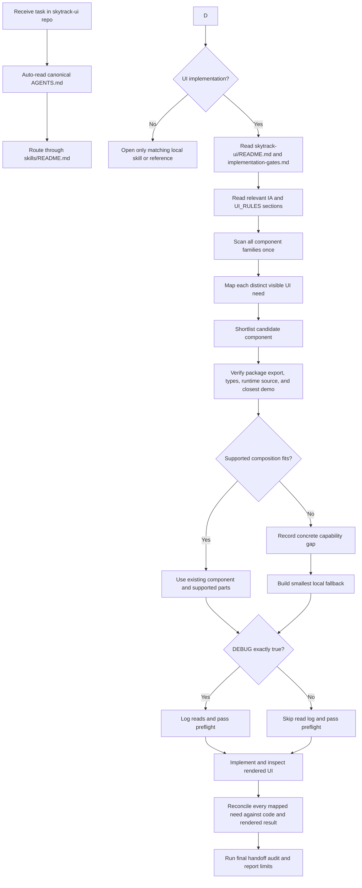

# SkyTrack UI Rule Flow and Structure

## Agent decision flow



## Repository tree

```text
skytrack-ui/
├── AGENTS.md                         # Canonical concise policy router
├── README.md                         # Library use, package status, and local rule links
└── skills/
    ├── README.md                     # Skill and archive index
    ├── archive/
    │   └── skytrack-ui/              # ARCHIVED marker for the former knowledge-only directory
    └── skytrack-ui/                  # Installable expertise skill
        ├── SKILL.md                  # Package expertise entrypoint
        └── references/               # Canonical rules, knowledge, architecture, and scripts
            ├── README.md             # Task-to-file router and implementation read order
            ├── implementation-gates.md # Mandatory component-first, token, evidence, handoff gates
            ├── implementation.md     # IA, task flow, chart and ambiguity method
            ├── UI_RULES.md           # Product, visual, content, typography, and token policy
            ├── AGENT_GUIDE.md        # Selective package implementation reference
            ├── knowledge/            # Component guides, research, and scoped domain knowledge
            ├── scripts/              # Optional DEBUG read-log and implementation handoff tools
            └── architecture/         # Explanatory flow/tree, not a duplicate policy source
```

## What each level does

| Level | Function |
|---|---|
| `AGENTS.md` | Canonical package router and required component-first implementation entrypoint. |
| `skills/README.md` | Routes to the active skill and archive marker. |
| `skills/skytrack-ui/SKILL.md` | Routes agents to package expertise without prescribing a consumer's full pipeline. |
| `skills/skytrack-ui/references/README.md` | Selects only the rules and evidence required by the current UI decision. |
| `skills/skytrack-ui/references/knowledge/` | Routes component candidates to verified API examples and Designer guidance. |
| `skills/skytrack-ui/references/knowledge/creative/` | Holds creative-direction knowledge, loaded only for marketing, graphics, or art direction. |
| `skills/skytrack-ui/references/scripts/` | Captures reads only when `DEBUG=true`; checks implementation evidence in both modes. |
| `skills/archive/skytrack-ui/` | Marks the previous knowledge-only directory layout as archived. |

## Normal component task read path

1. Follow root `AGENTS.md` and `skills/README.md`.
2. Read `skills/skytrack-ui/references/README.md`, mandatory `implementation-gates.md`, relevant IA guidance, and only the relevant `UI_RULES.md` sections.
3. Scan `knowledge/COMPONENT_ROUTING.md` once, then map each distinct need to a candidate and reuse/custom decision.
4. Read only shortlisted Developer pages and Designer pages needed for an active UX decision. Verify exact API and closest demo against the target installation.
5. Log reads only when `DEBUG=true`; always pass the preflight gate before UI changes and reconcile the map against source and rendered UI before handoff.

## Portability boundary

Every first-party rule, component knowledge page, and helper needed by this skill resides inside this repository. The parent SkyTrack workspace may link to these files, but this repository does not require that workspace to route or interpret its own UI pipeline. Independently installed skills remain siblings under `skills/` and are never treated as the authoritative component router.
