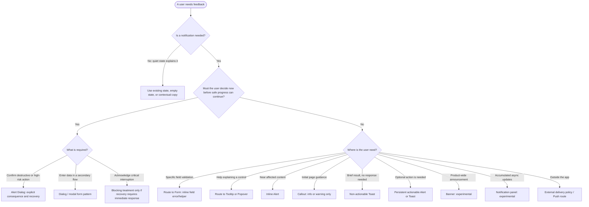

# Notifications — Decision-tree integration preview

> **Integrated:** The approved reusable taxonomy and notification-routing guidance are now in [`notifications.md`](./notifications.md). This file remains as the original decision-tree review draft.
>
> Feedback ranging from contextual, non-blocking status to an interruption that requires a decision.

- Pattern ID: `notifications`
- Catalog group: Core
- Source status: **Universal**
- Primary source: [maintained reference](../../../../../docs/carbon-ds-reference/patterns/notification-pattern/index.md)
- Catalog entry: [catalog.ts](../../../../../src/showcase/pattern-library/catalog.ts)
- Page copy, source citations, and demo map: [page-content.ts](../../../../../src/showcase/pattern-library/page-content.ts)
- Local interaction implementation: [demos.tsx](../../../../../src/showcase/pattern-library/demos.tsx)

## Decision summary

**Use when:** A user needs feedback about an action, validation, page context, a background event, or a blocking condition.

**Do not use when:** The user needs help understanding a control or must complete a secondary data-entry flow. Route those needs to Tooltip / Popover or Dialog patterns instead.

**Core rule:** Choose semantic status independently from presentation. Error does not automatically mean modal; success does not automatically mean toast.

## Authority and evidence

| Marker | Meaning |
| --- | --- |
| `STANDARD` | Accessibility requirement or WAI-ARIA behavior. Do not weaken. |
| `CARBON` | Adopted behavior from the maintained Carbon reference. |
| `SKYTRACK POLICY` | Product decision; Owner may change it. |
| `EXPERIMENTAL` | Source guidance is incomplete. Do not invent API or behavior. |
| `VERIFY` | Confirm installed component API, type, runtime source, and closest demo before implementation. |

## Required decision inputs

Do not select a notification type until these are known:

1. **Trigger and affected object:** What happened, to which mission, device, form, account, or workspace?
2. **Severity:** informational, success, warning, or error.
3. **Urgency and interruption:** Can work safely continue without an immediate response?
4. **Scope:** field, local panel, current page, entire product, historical feed, or external device.
5. **Required response:** none, optional action, required decision, or data entry.
6. **Persistence:** Can the user safely miss it? Must it remain until resolved?
7. **Recovery:** What exact action restores progress?
8. **History and delivery:** Must it be readable later, deduplicated, preference-controlled, or delivered outside the app?

If any required input is unknown, record it as unresolved. Do not let an implementation agent infer it.

## Decision workflow



### Ordered routing rules

1. **No notification:** Prefer a quiet state when the UI already explains the condition.
2. **Field validation:** Show an error next to the relevant field and retain it until valid. This belongs to the Form pattern, not a generic Toast.
3. **Control explanation:** Use Tooltip for brief non-interactive help; use Popover when richer or interactive content is needed.
4. **Immediate required decision:** Use Alert Dialog only for a consequential decision. A dialog must provide a meaningful recovery path; it is not the default for session expiry or connectivity loss.
5. **Contextual status or remediation:** Use Inline Alert near the affected control, panel, or form actions.
6. **Initial explanatory context:** Use Callout only on page load, only for informational or warning context, with no action button.
7. **Brief non-critical confirmation:** Use a non-actionable Toast. It may auto-dismiss only when it can safely be missed or reread elsewhere.
8. **Optional follow-up action:** Use one actionable notification with one concise action. It never auto-dismisses.
9. **Broad or historical delivery:** Banner and Notification panel remain experimental; do not claim persistence, preferences, deduplication, or API support without product policy and implementation evidence.
10. **External notification:** Push / OS delivery requires a separate consent, preference, platform, and deep-link decision. Do not request permission merely because the app loaded.

## Selection matrix

| Rule ID | Need and condition | Presentation | Persistence / action | Provenance |
| --- | --- | --- | --- | --- |
| `NOTIF-01` | Field validation fails | Inline field error / helper | Remains until valid; route to Form | Pattern boundary |
| `NOTIF-02` | User needs brief help with a control | Tooltip or Popover | Tooltip is non-interactive; route separately | WAI-ARIA boundary |
| `NOTIF-03` | Local task state, warning, or remediation | Inline Alert | Persist until resolved or explicitly dismissed | CARBON |
| `NOTIF-04` | Initial page guidance, info or warning | Callout | Persistent; no dismiss/action button | CARBON |
| `NOTIF-05` | Brief non-critical result, no action | Toast | Optional timeout only when safely recoverable | CARBON |
| `NOTIF-06` | Optional follow-up action, such as Undo | Actionable Alert / Toast | One concise action; never auto-dismiss | CARBON |
| `NOTIF-07` | Consequential decision blocks safe progress | Alert Dialog | Explicit decision and recovery; modal focus behavior | STANDARD |
| `NOTIF-08` | Product-wide announcement | Banner | Max one active; scrolls with page; experimental | CARBON / EXPERIMENTAL |
| `NOTIF-09` | Background events need later review | Notification panel | History, grouping, preferences need product policy | CARBON / EXPERIMENTAL |
| `NOTIF-10` | User is outside product context | Push / OS notification | Consent, preference, platform and deep-link required | VERIFY |

## Notification types

### Inline notification

Place persistent feedback beside the affected panel, input group, or immediately above relevant form actions. Include the affected object and recovery instruction for errors.

- Use for local warnings, errors, and persistent task state.
- Do not obscure working controls.
- Omit Close when resolution is mandatory.
- `VERIFY`: `Alert` API, role, icon, and close behavior.

### Toast notification

Use for brief, non-critical feedback after an action or background completion.

- A non-actionable Toast may auto-dismiss only when the user does not need to act and can recover the information.
- Do not put critical, required, or unrecoverable information in a timed Toast.
- Do not establish a hard timeout or stack limit unless SkyTrack Owner policy defines one.
- `VERIFY`: `Toast` provider API, timeout handling, queue behavior, and closest demo.

### Actionable notification

Use when the user may optionally take one immediate next step, such as Undo or View.

- Exactly one concise action.
- Never auto-dismiss.
- Do not assume focus is moved to the notice: focus behavior must be verified against the selected component and scenario.
- If text or actions exceed the compact notification boundary, route to a page, panel, or dialog instead.

### Callout notification

Use on initial page load for persistent context that helps the user understand a nearby control or state.

- Informational or warning status only.
- No dismiss button or action button.
- Use a short contextual text link only if it supports explanation rather than remediation.
- Do not use for action results, background events, success, or error.

### Banner notification — Experimental

Use only when a product-wide announcement needs high visibility across the page.

- Place below the global header and let it scroll naturally with page content.
- Show at most one active Banner.
- The source does not establish SkyTrack persistence, dismissal, priority, or implementation API. These require Owner policy and engineering evidence.

### Notification panel — Experimental

Use for accumulated asynchronous updates that users can inspect later.

- A panel may support chronological review, grouping, deduplication, unread state, and preferences.
- Those behaviors are not implemented policy by default; define them in the feature brief before dispatching implementation.
- Do not represent the local demo as evidence of storage, preferences, grouping, or deduplication.

### Modal notification

Reserve for critical conditions that truly require an immediate decision or acknowledgement.

- Do not show a modal merely to announce success.
- One blocking modal at a time.
- A modal must state what happened, what is blocked, and the recovery path.
- `STANDARD`: modal focus is contained while open and restored appropriately when closed.
- `VERIFY`: `AlertDialog` behavior, including Escape and outside-click behavior.

## Accessibility and interaction contract

- `STANDARD`: Do not move keyboard focus to a generic alert; status messages should be announced without requiring focus movement where appropriate.
- `STANDARD`: Do not auto-dismiss critical or actionable information.
- `STANDARD`: A modal dialog keeps focus within itself while open and restores focus appropriately after close.
- `STANDARD`: Tooltip is shown on hover or keyboard focus, is not focusable itself, and closes with Escape. Use another pattern for interactive content.
- `STANDARD`: Status changes that do not receive focus still need an appropriate programmatic announcement.
- `CARBON`: Actionable notifications persist and have one concise action.
- `SKYTRACK POLICY`: Queueing, maximum visible Toasts, notification history retention, grouping, deduplication, preferences, and Banner persistence must be explicitly specified per feature.

> Correct WCAG mapping: 2.2.3 **No Timing**, 2.2.4 **Interruptions**, and 4.1.3 **Status Messages**. Do not relabel these criteria.

## Builder handoff contract

A low-tier implementation agent may proceed only when the leader supplies every field:

```yaml
notification_id:
rule_id:
source_evidence:
trigger_and_affected_object:
status:
presentation:
component_mapping:
exact_copy:
action_and_recovery:
persistence_and_dismiss:
focus_and_announcement:
files_allowed:
acceptance_steps:
unresolved: []
```

If `unresolved` is not empty, or component support is not verified, stop and return the missing decision rather than guessing.

## Acceptance checks

- A validation error is visible beside its field and disappears only when valid.
- A non-actionable Toast does not contain required recovery work.
- An Undo or View notification persists and exposes only its approved action.
- A connectivity or session issue preserves the user’s work where product behavior permits; it is not automatically made modal.
- A Banner scrolls with content and only one is active.
- Tooltip content is reachable by keyboard focus and dismissed with Escape.
- Push permission is requested only from an approved, meaningful user action.

## Maintenance rule

Treat the catalog as the source for status, summary, component shortlist, and design decisions. Treat page content as the source for section guidance and demo teaching. Treat the rendered demo as evidence only for the behavior it visibly implements. Update this guide and [pattern routing](../PATTERN_ROUTING.md) when the pattern changes. Never treat local examples as production services or operational policy.
